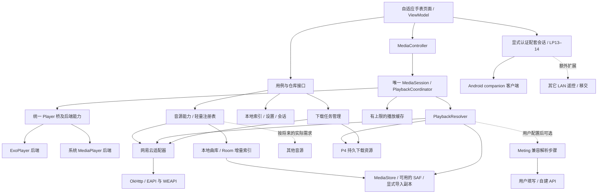

# 技术架构与接口

状态：拟议架构，尚未创建应用工程或实现接口。[21](21-本地播放器全量需求整合.md)确认本地F-001～F-128全部必做，包含原13项待定；逐项完整行为/AC见固定匿名基线，LP分组设计见[17](17-本地音乐功能与实施计划.md)，唯一任务DAG见05。候选技术方案不表示已验证能力，不提供工期、人日或代码量估算。

## 1. 总体方案

面向普通Android智能手表，Kotlin + Compose Foundation/Material3按实际窗口/形状适配。单个MediaSessionService维护一个MediaSession及一个活动后端，提供**系统MediaPlayer与Media3 ExoPlayer**两条必需后端选择；默认候选ExoPlayer。当前样机不是型号白名单，不依赖厂商私有接口或GMS。手表独立运行，Android手机配套是另外必须交付、用户按需连接的客户端。

共用页面按窗口大小、inset、字体及系统提供的形状/输入能力选择布局，方屏使用正常矩形可用区域，不能套用圆形裁切或靠设备名称判断。minSdk26仍为候选；manifest 只声明实际必要的通用能力，不以品牌包名/厂商 feature 限制安装。支持范围和设备实测覆盖分开记录。



图中两后端是选择关系，绝不同时活动。所有在线/本地/未来下载命令进入唯一会话，服务拥有队列、时间轴与播放意图；UI/通知/耳机/快捷菜单/手机端不得持有独立播放器或第二份权威状态。页面恢复通过MediaController连接；后端适配不是第二个MediaSession。在线和本地在共享基础后按05并行，最终公开门槛包括全部LP-00～LP-15，旧DEV任务不能代表仅有基础库即可完成。

## 2. 未来工程结构

DEV-004-A先建仅含`:app`的云端最小探针，DEV-004-B再测基线，P1扩充同一工程。手表职责先用包隔离；LP-14再增加实际必需的`:companion`，不在探针阶段预建空模块。本轮只描述未来结构。

```text
MeloX-Watch/
  android/
    app/                 # 首个探针的唯一模块；手表主产品
      src/main/kotlin/io/github/onlinemo/meloxwatch/
        ui/              # 页面与组件
        model/           # 曲目、队列、歌词与错误
        data/            # 网易云/本地适配、Room、授权和会话
        playback/        # 单会话、协调器、双后端适配、DSP与恢复
        lyrics/          # 解析与时间线
    companion/           # LP-14才建设；Android手机配套端
  docs/
  research/              # 已有研究资料，不加入产品 Gradle 依赖
```

播放和数据包不依赖`ui.*`、手机Activity或GMS。协议/序列化只提取真实双端共用契约，是否再建共享模块依据实际需要决定；手表本地核心不等待伴侣启动、配对或联网。P4在线下载仍按原阶段建设。

首版按网易云和本地的实际需要落地 [18 通用接口预留](18-通用音源接口预留.md)：`model` 定义来源身份、账号范围与资源，`data` 实现协议，19 的 Meting 是可选解析步骤。未来平台、登录方式和功能范围均不预定；页面/播放器不引用平台专用 DTO。

计划手表namespace/正式applicationId为`io.github.onlinemo.meloxwatch`，Debug为`io.github.onlinemo.meloxwatch.dev`。同仓库`android/:companion`计划正式包名`io.github.onlinemo.meloxwatch.companion`，Debug为`io.github.onlinemo.meloxwatch.companion.dev`；与09/10/12对齐，共用`version.properties`和固定工具链，APK逐包核验身份、版本、哈希及证书。两端不沿用来源应用身份，不因共享版本就假设签名/字节相同。依赖在实际云端验证后精确锁定，本轮不新增工程或工作流。

## 3. 技术选择与冻结点

| 项目 | 规划选择 | 冻结条件 |
| --- | --- | --- |
| Android 下限 | `minSdk 26` 为初始候选 | 实机 API + 依赖要求核验，低于 26 时重新评估 |
| compile/target SDK | 已固定 36，Build Tools 35.0.0 | 由 `.ci/toolchain.properties` 管理；实机行为仍待核验 |
| Gradle/AGP/Kotlin/Compose | Gradle 8.13 / AGP 8.11.1 / Kotlin 与 Compose 编译插件 2.2.21 | 云端唯一编译；Compose UI 等应用依赖在实现时精确锁定，见 09 文档 |
| UI | 普通 Compose 共用组件，圆屏适配＋方屏基础布局 | 按窗口/形状/inset验证；Watch X2为当前实机基线，未测设备不宣称通过；不要求新 Wear Compose 栈 |
| 音频 | ExoPlayer及系统MediaPlayer后端、一个MediaSession、显式适配桥 | 两后端基础控制/恢复、切换/失败、事件/线程映射及媒体会话通过；能力矩阵分开 |
| 网络 | OkHttp + Coroutines | 超时、取消、重试与序列化测试通过 |
| 数据 | Room 保存队列、本地增量索引/来源/播放列表/收藏；DataStore 保存普通设置 | P1 确认兼容版本；禁止整库 SharedPreferences JSON；Cookie 不以明文写入这些存储 |
| 封面 | Coil 或同等轻量加载器 | 按实际显示尺寸解码，有磁盘/内存上限 |
| 凭证 | Android Keystore 包装密钥 + 加密应用私有存储 | 重启、密钥失效、退出/切账号场景通过 |
| 下载 | 优先 Media3 DownloadManager/DownloadService + 业务索引 | P4 证明签名 URL 刷新、暂停恢复与无淘汰下载缓存可行 |
| 本地访问 | MediaStore + 实际固件支持的 SAF 文件/目录选择；必要时显式导入副本 | P0 DEV-005 证明存在可用访问路径和授权恢复方式；不假定选择器存在 |
| 扩展解码与DSP | APE、DSF/DFF输出PCM、速度/保调、EQ、ReplayGain、左右增益、压限器是必需能力；具体库/版本暂不锁定 | LP-05/06核验许可、ABI、提取/seek/PCM链、包体/性能及正常AC，不宣称原生DSD；DRM解密不纳入 |
| 手机配套 | Android独立客户端`:companion`，共用版本/工具链 | LP-14与手表逐包身份、协议、配对/撤销及真实双端AC；其它手机平台另定 |

## 4. 模型与接口契约

以下字段是设计契约，不是上游现成 API。由窄接口隔离上游对象与 UI。

| 对象/接口 | 关键内容 | 约束 |
| --- | --- | --- |
| `TrackKey` | `providerId`、字符串 `trackId`；本地使用 `local` + 稳定逻辑 ID | 不用曲名/相同标签当身份；URI 访问别名与逻辑身份分开，移位重关联保留历史 |
| `ProviderDescriptor / ProviderRegistry` | 稳定 providerId、显示信息、逐操作 capability、按需工厂 | 首版注册网易云/本地；未知来源明确不可用，不回退网易云；不构造全部候选客户端 |
| `AccountScope` | providerId、账号标识/匿名范围；本地设备范围 | 隔离凭证、缓存、请求 generation；账号退出不波及其他来源或本地库 |
| `Track` | key、原始元数据/解析版本、用户显示覆盖、有效显示字段、时长/格式/可用性 | 显示覆盖不是原标签写回，未知时长不是0；扫描不覆盖用户编辑 |
| `PlaybackResource` | 区分远程 URL + headers/有效期、本地 URI + 来源授权引用、P4 完整下载引用；记录实际格式 | 本地 URI 不走 HTTP/在线音质解析；远程 URL 作为短期资源，不永久写入队列 |
| `ResolverProfile / ResolverResult` | 服务标识、用户 endpoint/受限模板、启用状态、配置 generation；结果记录原 TrackKey 与实际解析服务/来源 | Meting 是当前明确要求的可选解析步骤，不重写 provider 身份；服务凭据独立加密，不传网易云 Cookie，默认无地址/无请求 |
| `QueueSnapshot / QueueEntry` | schemaVersion、generation/revision、完整结果引用、冻结视图版本、原序/实际播放序、当前实例ID/序号、position、shuffle/repeat/有限循环计数 | Room保存全部实例，完整逻辑范围不设10000条上限；内存窗口有界，资源按需；重复曲不同实例，恢复不洗牌且暂停 |
| `SessionSnapshot` | AccountScope、有效性、generation、加密凭证引用 | 平台特有凭证留在适配器网络边界，不进入页面或公共 DTO |
| `LyricsDocument` | 来源及授权/内容版本、稳定行ID、时间/字片段/译文关联、源offset及用户偏移 | 公共时间线统一毫秒；解码/CUE保留源采样或帧精度后明确换算。纯文本不假同步，每个承诺格式有正常样本 |
| `OfflineEntry` | 账户范围、TrackKey、稳定缓存 key、音质、大小、完成状态、歌词引用 | 不以临时 URL 作为唯一标识 |
| `AuthRepository` | 查询支持的登录方式、开始/继续/取消、校验账号、退出 | 网易云首版使用扫码；不强制未来平台同样有二维码；本地不需要该能力，回调校验 generation |
| `CatalogRepository / Page` | 按 capability 请求搜索、歌单等；日推/写入等为可选操作 | 统一分页契约，适配器内部转换 page/offset/cursor；续页绑定来源/账号/查询，真实结束，不支持不得伪造空结果 |
| `LocalTrack / LocalSource` | 逻辑 ID、URI 别名、来源/授权、元数据、变化指纹、可用状态、扫描 generation | 本地曲库为设备范围；URI 不转换成猜测绝对路径；缺失或撤权保留记录 |
| `LocalLocation / Segment` | 实体访问位置、所有权/来源能力、contentRevision；CUE文档身份/轨号、实体引用、起止及边界版本 | 段TrackKey与实体分开，多段共享文件；重扫稳定，文件写删先列全部影响，seek不越段 |
| `BackendCapability / PlaybackConfiguration` | 后端/设备/API/ABI/格式/路由组合、支持/未知/失败、请求值与实际生效值、验证依据 | 不从扩展名或单一bool推导全格式/DSP；未知不能算支持，后端不同能力可见 |
| `PlaybackEvent / ListeningAggregate` | 唯一事件ID、播放意图/后端/队列代次、单调时间段、日期/时区、有效聆听及计次规则版本 | 历史与统计只消费权威事件，重复回调幂等，倍速/seek不伪造聆听时长 |
| `FileOperation / RestoreRun` | operationId、精确对象/内容revision、确认范围、暂存/校验/外部结果/索引协调状态及恢复记录 | 数据库事务不等于provider原子写；中断回读真实结果，不能重复作用同名新文件 |
| `LocalLibraryRepository` | 分页分类/搜索/排序、批量增量写入、扫描状态、授权恢复 | Room 查询和事务；失败/取消扫描不把未见记录判为已删除 |
| `LocalPlaylistRepository` | 普通/文件夹规则歌单、成员序/人工覆盖/revision、本地收藏、M3U/M3U8及JSON交换 | 事务存稳定身份；自动歌单仅完整扫描更新，失败不清成员；不修改活动队列/音频 |
| `PlaybackResolver` | 按来源分派：本地 URI；在线条目先检查有权限的完整下载，再按联网策略解析 URL | 本地缺失/撤权禁止回退在线搜索；单曲失败不造成无界自动跳歌/重试 |
| `DownloadRepository` | 添加、暂停、恢复、删除、观察任务 | 下载资源权限与播放权限分开判断 |
| `CompanionSession` | 目标认证身份、协议版本、短期会话、权限域、operationId、revision、传输状态 | LP-13/14必需实现但运行时默认关闭；不传账号凭据/任意路径，不成为离线核心前置 |
| `AssetImport / VersionedExport` | 类型/schema、输入字节/条目/深度/像素限制、资源摘要、预览/暂存代次、授权与许可 | 主题/字体/歌词/歌单/全量备份分别校验，不以URI可读推定安全；未完成输出不标成功 |

错误统一映射为 `LoginRequired`、`NetworkUnavailable`、`RateLimited(retryAfter)`、`ResourceUnavailable`、`UnsupportedFormat`、`StorageFull`、`PermissionDenied`、`Unknown(code)`；本地补充 `PermissionRevoked`、`FileMissing`、`SourceUnavailable`、`MetadataUnreadable` 和取消/部分完成状态。取消、证书错误、限流和账号错误不得混成可自动回退的资源不可用，Meting 分类见19。拒绝或撤权不是空库成功；恢复授权后重试原来源，不删除索引、收藏和列表成员。页面不直接展示原始响应或包含凭证的请求地址。

### 4.1 Room、升级和系统备份

P1 起导出并保存 Room schema；首个公开 schema 发布前确定索引/队列/列表的事务边界和版本策略。每次 schema 变更提供显式 migration，并从已交付 schema 验证收藏、顺序、稳定身份和队列可恢复；无历史公开版本时记录初始建库及未来迁移基线，不能声称已测不存在的升级。禁止 destructive fallback；不支持降级或迁移失败时保留数据库并给出恢复/升级入口，不自动清库。

系统自动云备份仍关闭，候选`allowBackup=false`及适用版本的`dataExtractionRules`/`fullBackupContent`排除数据库、设置、凭证、URI、缓存和音频；凭据密文在`noBackupFilesDir`。OEM设备迁移不能仅凭一个开关保证，须实测；Keystore失效只影响相关凭据，不清本地库。[O-BACKUP][O-ROOM]

**F-068/F-069用户显式导出/恢复必须实现**，与系统自动备份分开。导出选择收藏/歌单/偏好/资源范围、预览敏感信息，默认不含音频；排除账号凭据、配对密钥、系统授权能力及不可移植路径。恢复先验schema/限额/摘要，再预览合并/替换；在独立代次暂存、完整后提交，不先清库。Room内事务可原子替换关系，Room与DataStore/文件不天然同一事务：`RestoreRun`记录待应用配置版本，提交数据库与活动设置代次后幂等完成投影，重建可回到上个有效版本。失败保留现库，URI字符串不能恢复授权，音频重新授权/定位；恢复不自动启用联网/传输/播放。具体v1格式和默认冲突策略见17的LP-09/11。

## 5. 账号与接口调用

二维码流程：申请 key → 本地生成二维码 → 仅在页面前台且网络可用时轮询 → 收到确认 → 提取会话 → 调用账号接口验证 → 原子保存 → 刷新音乐库。

轮询建议初始 2–3 秒，可根据服务端返回退避；过期后由用户刷新或进行一次有上限的自动更新。离开页面取消任务；对快速刷新后的旧成功响应使用 generation 校验。不能仅因拿到非空 Cookie 就认为账号有效。

| 功能 | 上游可核对的请求/入口 | 计划处理 |
| --- | --- | --- |
| QR key / 状态 | Watch API 中 `/api/login/qrcode/unikey`、`/api/login/qrcode/client/login`；Android 网页桥接 | P0 验证渠道与参数，不混用 type 或 Cookie 语义 |
| 账号 | `NeteaseSearchClient.accountProfile`、Watch API | 存储前校验，明确未登录和过期 |
| 搜索 | `NeteaseSearchClient.searchSongs`；UniversalSearch 仅作其他搜索类型参考 | 新增歌曲 offset/page 契约并验证响应总数/末页；两个现有搜索入口都不能直接提供完整歌曲分页 |
| 喜欢/歌单/日推 | `NeteaseLibraryClient` | 先取摘要；详情分批，不一次请求数千首 |
| 播放 URL | `NeteaseQualityClient` 的 player URL 路线 | 请求前绑定账号；检查空 URL、试听、音质和格式 |
| 下载 URL | `NeteaseQualityClient` 的 download URL 路线 | 验证下载可用性后才创建任务；播放 URL 回退另行决策 |
| 在线歌词 | `NeteaseSearchClient.lyrics`、Watch API 的 lyric 路线 | 原在线协议保持LRC读取及统一时间线；本地内嵌/译文/逐字依LP-07另补承载路径，不借在线协议限制删项 |

所有接口都是第三方项目已有实现，未在本次在线验证。协议变化风险通过适配器、脱敏响应样本和契约测试控制；不把它们当作音乐平台提供稳定性承诺的公开 API。

退出和切账号需要取消旧请求、清除会话及该账号的 URL 缓存、停用旧账号的下载任务、隔离在线音乐库。已下载内容是否删除由明确的本地操作控制，不能让另一个账号自动继承其资源访问状态。设备本地曲库、URI 授权、导入副本、本地收藏/列表/历史不属于在线账号，退出或过期不能清除这些数据、挡住本地菜单或中断当前本地播放；混合队列中的在线条目按所属账号标记不可用，保留本地条目及其稳定引用。Keystore 不可用时应提示会话无法持久化或要求重登，不降级到明文凭证。

## 6. 播放与后台服务

1. 用户在前台选择曲目，UI 发出播放命令，服务建立/更新队列。
2. 按来源分派：本地验证URI/分段和当前后端能力，不调用账号/网络；在线先检查有权限的完整下载，再依策略解析短期URL。19允许的同ID资源失败才在剩余预算内尝试一次Meting；本地错误不回退线上同名歌。
3. 缓存 key 包含 provider、曲目、音质与必要账号范围，避免 URL 换签后重复缓存或串号。
4. 会话桥/协调器候选主Looper，Controller依其applicationLooper，后端API各遵守所属线程；IO完成回所有者线程校验意图/曲目/队列/后端代次。双后端共用一个焦点及noisy所有者：候选协调器统一处理，ExoPlayer对应自动处理关闭，MediaPlayer不另立重复监听；如最终委托某后端，先释放旧所有者再接管，不能混用。焦点偏好默认开，关闭不豁免系统启动/请求条件和输出安全。[O-AUDIO]
5. 曲目、模式、队列改变时持久化；播放位置按有上限的间隔保存，暂停/跳转时立即更新。不能只依赖 `onDestroy`。
6. 进程恢复后装载快照并等待用户恢复，重新解析过期 URL；网络恢复不会触发意外外放。

规划使用 `FOREGROUND_SERVICE`、适用系统上的 `FOREGROUND_SERVICE_MEDIA_PLAYBACK` 以及 `foregroundServiceType="mediaPlayback"`，依据 O01。compile/target 为36、minSdk仍是26候选；在 Android 15+ 且 target≥35 时，请求焦点须为顶部应用或已运行合规前台服务，仅“创建了 Service”不足够。DEV-002/103 验证可见用户操作、服务启动/通知时序和焦点失败时的暂停反馈；拒绝时不循环重启或偷偷发声。短暂抢占的恢复只限同一次有效播放意图；用户暂停、noisy、切歌/账号失效后禁止旧焦点回调恢复。强制停止/重启不自动拉起。[O-AUDIO]

权限按能力申请：网络权限供既定在线及用户显式启用的本地辅助/传输，不能挡住本地核心入口；Android 13+通知权限包括拒绝后的媒体会话需实测。只有主动调用需要权限的蓝牙查询/连接API才考虑`BLUETOOTH_CONNECT`等适用权限，音频路由播放不等于必须扫描蓝牙。MediaStore读取按实际API/target申请READ_MEDIA_AUDIO或适用旧版读取权限；SAF按实际文件/树授权持久化，不从读权推定写删。拒绝可退已证入口，不绕授权、不用MANAGE_EXTERNAL_STORAGE或root。P4下载在应用私有目录；本地探针见07/17。

任一时刻一个活动后端，不做AutoMix双播放器预载。屏幕不可见停封面/歌词/进度视觉更新，必要音频继续；唤醒按实际播放需要，不常驻。F-103仅用户显式开启且可见歌词页可保持屏幕，离页/后台/结束解除，不是服务保活策略。

### 6.0 后端桥、切换与处理链

`PlaybackCoordinator`拥有状态、队列和命令序列；`Player`桥向唯一MediaSession暴露稳定事件/时间轴/命令可用性，下面适配MediaPlayer和ExoPlayer。桥必须实现准备/缓冲/结束/错误、seek完成、时长未知、音频会话ID、可用命令及异常重连映射。它是待实现的明确工作，不能宣称MediaPlayer可直接作为Media3 Player或两者事件语义相同。所有页和系统控制读取统一有效元数据；后端不得各写一份历史、歌词时钟或统计。

切换状态：`Active → Saving → Pausing → Releasing → Creating → RestoringPaused`，失败为`SwitchFailedPaused`。确认时冻结新命令代次，保存当前QueueEntry、段内位置、实际序列/循环计数、请求DSP配置；暂停并释放效果、旧内核及其焦点/noisy所有权，确认释放后才建新内核。旧回调按backendGeneration拒绝。建立后重新核验URI/seek/格式/路由能力，绑定桥与有效audioSession，恢复到暂停；能力不兼容列请求值/实际值，不能偷偷换曲、自动发声或假生效。取消在释放前保留原配置，释放后的取消安全停留暂停；失败可显式重建旧后端暂停，不能通过并存旧实例“回滚”。媒体Controller若需重连只连接原唯一会话。

功能能力表按后端×容器/编码参数×设备/API/ABI×路由记录seek、速度/保调、gapless、CUE段、EQ、左右增益、ReplayGain及压限；未知/不支持/已证分别标记。后端差异允许，但每个必需功能都必须有至少一个正常支持组合，异常提示不能代替正常AC。原用户偏好与实际生效配置分别持久化，切换效果重建/取消预览不丢已保存配置。

PCM处理候选顺序：解封装/段范围→解码→速度/保调→ReplayGain/preamp→EQ→左右增益→压限器→输出。系统媒体音量以当前路由系统值为权威，不并入应用增益。ReplayGain标签、峰值前置保护和动态压限分开，增益只应用一次；无标签不猜，极值/切路由用平滑和明确回退。ExoPlayer受控PCM链优先，MediaPlayer以实际平台会话效果验证；offload/直通是否绕过处理必须检测/验证，不能亮开关却无音频作用。若平台EQ发生于压限之后，须调整链或限制该组合，不能声称受到末级保护。

APE、DSF/DFF须有extractor/decoder/seek/段结束和输出链的真实实现；DSF/DFF初版明确转PCM，不宣称原生DSD/DoP。库许可、维护、ABI、云端构建、包体、温升/耗电先审再锁具体版本。CUE实体文件与虚拟段分离，段内媒体时钟映射实体时间；共享文件写删影响所有段。无缝依单一后端连续时间线与真实delay/padding，可有界准备下一资源，但不靠第二播放器交叉淡化；同/跨采样率、速度/DSP组合和尾帧连续样本分别验证。17记录参数候选，14统一资源与测量阈值，未测不称已支持。

### 6.1 队列冻结、模式和失败

点歌策略F-079可询问、插入后播放或用当前列表建队列，F-086必须纳入当前本地筛选/排序的完整有序结果，不能只加已显示页。冻结来源/账号、查询、排序（含稳定ID）和数据库revision；队列准备在独立generation分批写全部轻量引用，校验范围/数量/版本完整后短事务发布活动指针。需要一致快照的查询采用可复核的数据库读视图或版本化成员记录，不在每批中混用新旧视图；旧revision不能保留时中止并提示重新准备。IO/网络不包数据库事务，失败/取消/空间不足保留旧完整队列、清本次未发布暂存，不发布半队列。

本地“全部”没有固定10000条上限；资源边界见下文。在线原有“已加载范围播放”保持明确范围标签，不能叫“全部”；若在线也提供全部播放动作，必须逐页确认完整范围后发布，不能用未加载来截断F-086的本地承诺。后续扫描/列表改序不改已冻结队列，权限/可用性可更新状态。

逻辑队列全部保存在Room；原序、实际随机序、当前位置和重复实例独立存储，不在内存持有整个列表。候选查询批100、UI最多3页、后端窗口当前及相邻各1项，具体容量由14冻结；只按需解析窗口资源，下一曲音频准备仅用于经验证的无缝路径并计入预算。数据库空间、准备取消/超时有真实错误及回滚，不以要求用户缩小范围作为唯一成功路径。随机用有界分批物化实际顺序，避免全量内存洗牌；恢复使用已保存序列而非仅seed。窗口换页需把后端索引映射稳定QueueEntryId，系统下一首/重复/队列编辑不能越出窗口就假结束。

| 操作 | 确定语义 |
| --- | --- |
| 顺序 / 列表循环 / 单曲循环 | 随机为独立开关；循环为关闭、列表、单曲。自然结束：关闭时队尾停止；列表在队尾回首；单曲重播当前成功资源。失败不触发单曲无限重播 |
| 手动上一首/下一首 | 按已保存播放顺序移动一个条目，忽略单曲循环；只有列表循环可在首尾环绕，其他情况边界提示并保留当前条目；重播本曲可 seek 到0 |
| 随机切换与恢复 | 开启时固定当前条目，把其余引用随机排列一次，保存实际顺序和当前索引；关闭时回冻结的原顺序并定位同一条目。恢复读取所存顺序，不能重新洗牌或只存随机开关 |
| 点选队列项 / 从新视图点歌 | 队列内选择按实例ID从0开始；新视图点歌执行F-079选定策略，只有完整列表替换策略建新快照。seek只改进度，恢复加载快照后等待明确播放 |
| 点选策略/完整播放 | F-079三种策略均保留，默认候选询问；F-086全结果原子发布、显示替换及起点；取消保持旧队列 |
| 编辑队列 | 插入下一首按多选顺序、operationId幂等；移除/移动精确实例、revision冲突明确处理；歌单编辑不联动队列 |
| 有限循环/随机单曲 | F-080候选启用默认2次、含当前轮，成功自然结束才计次；seek不计、手动切实例重置、暂停/换后端保留。F-081达限才进持久随机序下一项；次数关则明确无限当前项，手动下一首可前进；单条队列有限达限停止 |

播放器错误最多自动刷新当前资源一次，仍绑定原曲目/账号/queueGeneration/请求代次；晚到结果在所有者线程拒绝。该刷新与19的补充解析共用本次操作的次数及剩余预算，不能重置预算或反复重 prepare。无网络、用户取消、证书失败、限流、需重登等直接给相应状态；附属封面/歌词失败不触发跳歌。

其他确定不可播项允许自动向后尝试，但一次连续失败链**最多跳过3项**，每项显示原因，到上限或无候选即停止；同一失败链不环绕重试已失败项。实际开始播放或用户明确重试/选歌才重置计数。仅本地播放意图遇混合队列中的在线项时显示“仅本地，已跳过在线项”，同样计入上限，不自动联网；打开本地菜单不会把已有在线/混合队列改成仅本地或中断正在播放的在线曲目。

## 7. 下载、缓存与离线一致性

本节是 P4 的在线持久下载，与首发 P2-L 用户文件曲库分开。存储所有权如下：

| 资源 | 所有权与删除边界 |
| --- | --- |
| 用户外部本地文件 | 本应用只保存授权 URI/索引；清缓存、退出、移除列表都不删除原文件 |
| 显式导入副本 | 应用管理的持久本地音频，独立配额；用户确认删除副本才释放音频，原文件保留 |
| P4 持久下载 | 按在线账号/下载权限管理；不当作用户本地库，不自动继承账号访问权 |
| 流媒体/封面/歌词缓存 | 有界、可重建、可清理；清理不删除前三类音频、本地索引或列表/收藏 |

F-053的明确物理删除、F-063标签写回、F-075重命名/移动是独立必需命令，不由上表的清理操作暗中触发。系统/用户拒绝和provider不支持不算成功；详细状态机见8.1及17。

流式缓存可按 LRU 淘汰；用户下载使用独立的无自动淘汰缓存和下载索引。Media3 下载服务、管理器及下载缓存的职责依据 O02，业务层仍需补充账号、实际音质、URL 更新和错误映射。

任务状态拟为：`Queued → Resolving → Downloading → Verifying → Completed`；旁路状态为 `Paused / WaitingForNetwork / WaitingForSpace / Failed / Removing`。数据库的 Completed 必须在音频完整性检查成功之后提交。歌词下载失败不伪装成音频失败，应单独显示“音频完成，歌词不可用”。

持久化稳定任务 ID、曲目 ID、账号范围、质量、下载索引关联和更新时间。重启后对下载索引、业务状态和缓存内容做协调，处理中断写入及半完成状态。Range 恢复只有在服务端支持且内容身份一致时使用；URL 过期先重新解析，内容变化则重新下载，不把不同版本字节拼接。

下载默认并发 1，Wi-Fi 优先，可显式允许其他网络；弱网播放缓冲时降低下载竞争。服务类型按适用版本使用 dataSync，并遵守其运行时限；长期暂停任务交给约束调度恢复，不让播放器服务永久承担下载保活。WorkManager 如使用，仅做调度/清理，不作为音频引擎。

## 8. P2-L 本地索引与资源边界

扫描使用全局有界队列，初始并发 1，批量写入 Room；候选批量 100 项及其他资源预算统一引用 [14-性能优先与资源预算](14-性能优先与资源预算.md)。文件遍历不放在数据库事务内，不为每个目录/文件创建独立 async；不每次启动全扫，不在列表查询时读取整库 JSON。元数据变更才重读，列表和搜索在数据库端分页/排序，UI 只消费结果。

扫描generation绑定来源、规则版本和完整范围；已见与解析成功分开，坏标签仍写lastSeen且保旧字段。仅完整成功、授权有效、代次未变才将未见位置标缺失；增量/取消/局部失败不清库。排除/短音频为独立隐藏状态，不当删除。tombstone/别名/操作日志计入实际数据库存储，空间不足停止新写入并明确未完成，不静默淘汰关系或假完整。前台推进、后台安全暂停、显式重扫见17；完整列表范围不能被随意数量配额截断。

封面当前/可见项按需降采样有界缓存；F-091显式刷新可选范围分批执行，取消不清可用结果。歌词同名/手动/内嵌来源共享解析模型，纯文本/行/字/译文按真实承载格式；默认无全库提取和联网。F-070/F-071是独立默认关闭、每次明确请求/最少信息/预览确认的例外，失败不改本地关联、不阻播放。导入/传入副本用暂存、配额/剩余检查和校验后提交，半文件不入库；字体/主题/备份/歌单也按类型独立有界输入，不能复用音频类型校验。完整契约与候选格式见17。

### 8.1 原文件事务、批量操作和恢复

`FileOperation`冻结operationId、精确Location/实体身份、contentRevision、操作类型/目标、确认范围及阶段。读取、写入、删除、重命名、移动和provider原子替换分别是能力；MediaStore按API/所有权及用户系统确认处理，SAF核验文档操作支持与授权，不能用content URI假造磁盘路径。取消/拒绝/部分成功逐项记录，系统已执行删除的返回先协调结果，不能盲目再执行；不存在跨provider通用事务或通用回收站。

状态流为`Requested → Confirmed → Staging → Validated → ExternalApplied → IndexReconciled`，旁路`Cancelled / Failed / Partial / NeedsRecovery`。内部Room关系可事务提交，外部字节与数据库分阶段协调；重启按日志复核原/目标状态，不用同名匹配、不可重放不确定删除。单实体操作串行，操作影响当前音频时先告知停播并暂停、关闭句柄；扫描提交检查内容版本，旧元数据不能覆盖新标签。

标签写回先生成完整暂存候选并独立检查标签/音频载荷，再按已验证provider替换或恢复方案应用；若不能保全原件，原件写入口说明限制，可另存副本，但副本/显示别名不是原件写回正常AC。原件改后更新所有可靠别名、重读元数据并保TrackKey/收藏/歌单；CUE段列共享实体影响。跨provider移动必须先复制校验完成、用户确认源删除，删除失败明确保两份，绝不把目标已完成文件当临时垃圾清理。

批量选择按完整筛选范围或显式ID冻结，不仅当前页；“移出索引”“删除原文件”“删除应用副本”分别命名。用户取消只阻未执行项，已完成结果不虚构回滚；关系编辑不触碰文件。操作日志有可回收生命周期但未协调恢复项不能静默淘汰。详细安全边界、格式字段和样本见17的LP-10。

## 9. 手机协同与 Wear OS 扩展

LP-13/14必须交付认证Wi-Fi传歌与真实Android配套端，默认关闭、用户限时开启并确认目标，断连不阻手表核心。手机端支持所选文件上传、主题编辑上传及设备确认应用、曲库/专辑/艺人分页、歌单CRUD/顺序和授权显示元数据管理。设备数据库是权威，手机草稿/缓存标版本和时间；operationId幂等、revision冲突不静默覆盖。音频上传、读库、写歌单、写显示字段、主题上传为独立权限域，物理写删另走8.1确认。

初版认证候选TLS及双方核对一次性配对码/公钥指纹、短期token、目标身份绑定；传输暂存/大小/摘要与副本提交流程复用，未经认证不能读取曲库或任意文件。协议/字段/schema、过期/撤配对/重传和后台限制需双端验证，不能把“局域网”视为认证。模块/包名和逐包产物按第2节及09/10/12。

既有LAN v1的UDP发现、TCP行式JSON及PIN仅供额外遥控/队列移交研究，设备名/ID不是密码学身份。[A10] 不能直接用于新增隐私数据/文件操作，不把旧`transfer`命令等同F-066文件传输。手机实际平台已选Android；其它手机平台需另作决定，不影响当前必需客户端范围。

账号同步单独立项：短期一次性配对、用户可核对身份、加密且认证的通道、最小凭证传输、撤销和重放防护；需要手机端新增实现。不能把 Cookie 放进原有明文 LAN 消息，更不能把 Apple WCSession 模型直接视为 Android 传输方案。

Wear OS 变体在扩展阶段验证 `android.hardware.type.watch` 声明、独立应用元数据、返回/表冠行为和分发要求。Data Layer 仅在实际支持的设备与手机组合中作为可选通道，账户/音乐请求继续直接联网；Google 文档对其设备范围和网络用途有明确限制。[O03][O04] Tiles/Complications 不属于兼容第一步。

## 10. 代码来源与维护

每个提取文件记录上游路径、提交、修改理由和验证用例；先提取边界最小的一组代码，再运行接口和模型测试。上游更新按具体变更审查，不自动合并整个手机应用。

DEV-004-A锁探针依赖，P1扩共享播放/Room，在线/Meting维持既定协议，全部本地LP-00～LP-15按05集成。首个完整公开候选依09/10/12完成手表与伴侣产物冻结、逐包验收/发布准备，P4/P5再扩在线下载；14/15/16及全部本地/Meting门槛不能推后。能力探针失败列具体阻断及后续决定，不自动删功能或虚称完成。

补充官方依据（实施时核对锁定版本；不代表设备已验证）：

- O-AUDIO 音频焦点与 Media3 自动管理：`https://developer.android.com/media/optimize/audio-focus`
- O-BACKUP 自动备份、排除规则与 OEM 设备迁移限制：`https://developer.android.com/identity/data/autobackup`
- O-ROOM Room 迁移与破坏性回退风险：`https://developer.android.com/training/data-storage/room/migrating-db-versions`
