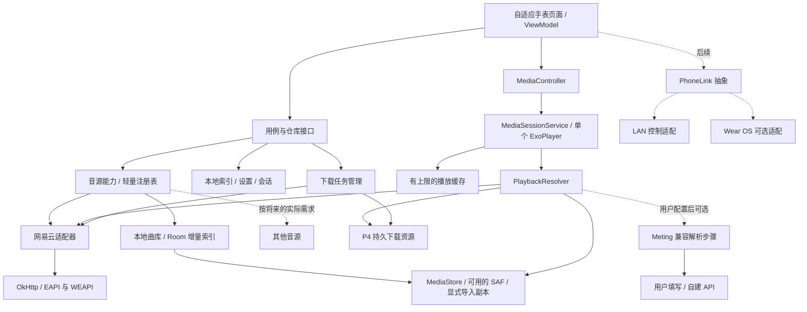

# 技术架构与接口

状态：拟议架构，尚未创建 Gradle 工程或实现任何接口。上游事实参见 [01 项目研究](01-上游项目研究.md)，平台依据参见 [08 来源](08-研究来源与决策记录.md) 中 O01–O05。

## 1. 总体方案

面向普通 Android 智能手表，Kotlin + Compose Foundation/Material3 按实际窗口/圆方形状适配 UI，Media3 的 ExoPlayer + MediaSessionService 承担音频。OPPO Watch X2 仅为当前主测设备，不设型号白名单、不依赖 OPPO 私有接口或 GMS；未来 Wear OS 专属集成另行评估。

共用页面按窗口大小、inset、字体及系统提供的形状/输入能力选择布局，方屏使用正常矩形可用区域，不能套用圆形裁切或靠设备名称判断。minSdk26仍为候选；manifest 只声明实际必要的通用能力，不以品牌包名/厂商 feature 限制安装。支持范围和设备实测覆盖分开记录。



UI 不持有第二个播放器。在线、本地文件及未来下载的所有播放命令进入同一会话，歌曲/队列/播放状态由服务权威维护；页面恢复通过 MediaController 重新连接。P2-L 在 P1 的共享播放基础上接入，与在线 P2 可并行；在线 DEV-206 和本地 DEV-211–216 功能就绪后进入 P3，DEV-217/218 与 DEV-301–304 集成收敛，最终 DEV-305 等待全部验收通过。完整本地契约见 [17-本地音乐功能与实施计划](17-本地音乐功能与实施计划.md)。

## 2. 未来工程结构

DEV-004-A 先建可云端编译的最小探针，供 DEV-002/003/005 使用；DEV-004-B 再测基线。P1 扩充同一工程。首期只有一个 `:app` Gradle 模块，以下均为其中的职责包，不预建五个空模块。

```text
MeloX-Watch/
  android/
    app/                 # 唯一模块；watchAndroid 主变体
      src/main/kotlin/io/github/onlinemo/meloxwatch/
        ui/              # 页面与组件
        model/           # 曲目、队列、歌词与错误
        data/            # 网易云/本地适配、Room、授权和会话
        playback/        # 单播放器、会话、解析与恢复
        lyrics/          # 解析与时间线
  docs/
  research/              # 已有研究资料，不加入产品 Gradle 依赖
```

播放和数据包不得依赖 `ui.*`、手机 Activity 或 GMS。仅在实际依赖隔离或复用有收益时再拆 Gradle 模块；P4 下载及可选协同到相应阶段才建设。

首版按网易云和本地的实际需要落地 [18 通用接口预留](18-通用音源接口预留.md)：`model` 定义来源身份、账号范围与资源，`data` 实现协议，19 的 Meting 是可选解析步骤。未来平台、登录方式和功能范围均不预定；页面/播放器不引用平台专用 DTO。

计划 namespace / 正式 applicationId 为 `io.github.onlinemo.meloxwatch`，Debug applicationId 为 `io.github.onlinemo.meloxwatch.dev`，与09一致；不能沿用上游包名或签名。云端核验精确包名，依赖版本在 DEV-004-A 验证后锁定。

## 3. 技术选择与冻结点

| 项目 | 规划选择 | 冻结条件 |
| --- | --- | --- |
| Android 下限 | `minSdk 26` 为初始候选 | 实机 API + 依赖要求核验，低于 26 时重新评估 |
| compile/target SDK | 已固定 36，Build Tools 35.0.0 | 由 `.ci/toolchain.properties` 管理；实机行为仍待核验 |
| Gradle/AGP/Kotlin/Compose | Gradle 8.13 / AGP 8.11.1 / Kotlin 与 Compose 编译插件 2.2.21 | 云端唯一编译；Compose UI 等应用依赖在实现时精确锁定，见 09 文档 |
| UI | 普通 Compose 共用组件，圆屏适配＋方屏基础布局 | 按窗口/形状/inset验证；Watch X2为当前实机基线，未测设备不宣称通过；不要求新 Wear Compose 栈 |
| 音频 | Media3，同组组件保持一致版本 | 本地/网络播放、音频焦点与通知通过 |
| 网络 | OkHttp + Coroutines | 超时、取消、重试与序列化测试通过 |
| 数据 | Room 保存队列、本地增量索引/来源/播放列表/收藏；DataStore 保存普通设置 | P1 确认兼容版本；禁止整库 SharedPreferences JSON；Cookie 不以明文写入这些存储 |
| 封面 | Coil 或同等轻量加载器 | 按实际显示尺寸解码，有磁盘/内存上限 |
| 凭证 | Android Keystore 包装密钥 + 加密应用私有存储 | 重启、密钥失效、退出/切账号场景通过 |
| 下载 | 优先 Media3 DownloadManager/DownloadService + 业务索引 | P4 证明签名 URL 刷新、暂停恢复与无淘汰下载缓存可行 |
| 本地访问 | MediaStore + 实际固件支持的 SAF 文件/目录选择；必要时显式导入副本 | P0 DEV-005 证明存在可用访问路径和授权恢复方式；不假定选择器存在 |
| Native 依赖 | 首发使用平台解码，不引入额外解码器或 DRM 解密 | MP3、AAC/M4A、FLAC、WAV、Ogg/Opus 按容器＋编码实测；不支持时给错误并记录范围 |

## 4. 模型与接口契约

以下字段是设计契约，不是上游现成 API。由窄接口隔离上游对象与 UI。

| 对象/接口 | 关键内容 | 约束 |
| --- | --- | --- |
| `TrackKey` | `providerId`、字符串 `trackId`；本地使用 `local` + 稳定逻辑 ID | 不用曲名/相同标签当身份；URI 访问别名与逻辑身份分开，移位重关联保留历史 |
| `ProviderDescriptor / ProviderRegistry` | 稳定 providerId、显示信息、逐操作 capability、按需工厂 | 首版注册网易云/本地；未知来源明确不可用，不回退网易云；不构造全部候选客户端 |
| `AccountScope` | providerId、账号标识/匿名范围；本地设备范围 | 隔离凭证、缓存、请求 generation；账号退出不波及其他来源或本地库 |
| `Track` | key、标题、艺人、封面、时长、可用性 | 元数据可显示不意味着可播放 |
| `PlaybackResource` | 区分远程 URL + headers/有效期、本地 URI + 来源授权引用、P4 完整下载引用；记录实际格式 | 本地 URI 不走 HTTP/在线音质解析；远程 URL 作为短期资源，不永久写入队列 |
| `ResolverProfile / ResolverResult` | 服务标识、用户 endpoint/受限模板、启用状态、配置 generation；结果记录原 TrackKey 与实际解析服务/来源 | Meting 是当前明确要求的可选解析步骤，不重写 provider 身份；服务凭据独立加密，不传网易云 Cookie，默认无地址/无请求 |
| `QueueSnapshot` | schemaVersion、queueGeneration、条目 ID/TrackKey/账号范围、冻结视图版本、原顺序/播放顺序、当前条目及索引、positionMs、shuffle/repeat | Room 保存有序引用，资源按需解析；重复曲目用不同条目 ID 区分；恢复保留随机顺序和索引，默认暂停，详见6.1 |
| `SessionSnapshot` | AccountScope、有效性、generation、加密凭证引用 | 平台特有凭证留在适配器网络边界，不进入页面或公共 DTO |
| `LyricsDocument` | 按时间排序的行、可选字词/翻译、来源、偏移 | 所有时间归一为毫秒 |
| `OfflineEntry` | 账户范围、TrackKey、稳定缓存 key、音质、大小、完成状态、歌词引用 | 不以临时 URL 作为唯一标识 |
| `AuthRepository` | 查询支持的登录方式、开始/继续/取消、校验账号、退出 | 网易云首版使用扫码；不强制未来平台同样有二维码；本地不需要该能力，回调校验 generation |
| `CatalogRepository / Page` | 按 capability 请求搜索、歌单等；日推/写入等为可选操作 | 统一分页契约，适配器内部转换 page/offset/cursor；续页绑定来源/账号/查询，真实结束，不支持不得伪造空结果 |
| `LocalTrack / LocalSource` | 逻辑 ID、URI 别名、来源/授权、元数据、变化指纹、可用状态、扫描 generation | 本地曲库为设备范围；URI 不转换成猜测绝对路径；缺失或撤权保留记录 |
| `LocalLibraryRepository` | 分页分类/搜索/排序、批量增量写入、扫描状态、授权恢复 | Room 查询和事务；失败/取消扫描不把未见记录判为已删除 |
| `LocalPlaylistRepository` | 列表 CRUD、成员增删/顺序、本地收藏 | 事务持久化，不改外部文件或在线歌单；成员引用稳定逻辑 ID |
| `PlaybackResolver` | 按来源分派：本地 URI；在线条目先检查有权限的完整下载，再按联网策略解析 URL | 本地缺失/撤权禁止回退在线搜索；单曲失败不造成无界自动跳歌/重试 |
| `DownloadRepository` | 添加、暂停、恢复、删除、观察任务 | 下载资源权限与播放权限分开判断 |
| `PhoneLink` | capabilities、状态、命令、队列移交 | 可选，不进入独立播放的关键路径 |

错误统一映射为 `LoginRequired`、`NetworkUnavailable`、`RateLimited(retryAfter)`、`ResourceUnavailable`、`UnsupportedFormat`、`StorageFull`、`PermissionDenied`、`Unknown(code)`；本地补充 `PermissionRevoked`、`FileMissing`、`SourceUnavailable`、`MetadataUnreadable` 和取消/部分完成状态。取消、证书错误、限流和账号错误不得混成可自动回退的资源不可用，Meting 分类见19。拒绝或撤权不是空库成功；恢复授权后重试原来源，不删除索引、收藏和列表成员。页面不直接展示原始响应或包含凭证的请求地址。

### 4.1 Room、升级和系统备份

P1 起导出并保存 Room schema；首个公开 schema 发布前确定索引/队列/列表的事务边界和版本策略。每次 schema 变更提供显式 migration，并从已交付 schema 验证收藏、顺序、稳定身份和队列可恢复；无历史公开版本时记录初始建库及未来迁移基线，不能声称已测不存在的升级。禁止 destructive fallback；不支持降级或迁移失败时保留数据库并给出恢复/升级入口，不自动清库。

首版不承诺自动云备份或跨设备恢复。设置 `allowBackup=false`，同时配置适用版本的 `dataExtractionRules`（云备份与设备迁移）及 `fullBackupContent` 排除规则，覆盖数据库、设置、凭证、URI、缓存和音频；凭证密文置于 `noBackupFilesDir`。部分 OEM 的设备迁移不受单一开关保证，须在目标设备核验，不能写“绝不会迁移”。恢复出 URI 字符串不等于恢复授权；Keystore 丢失仅使相关在线/服务凭据需重登或重填，不删本地索引、列表、收藏或音频。[O-BACKUP][O-ROOM]

## 5. 账号与接口调用

二维码流程：申请 key → 本地生成二维码 → 仅在页面前台且网络可用时轮询 → 收到确认 → 提取会话 → 调用账号接口验证 → 原子保存 → 刷新音乐库。

轮询建议初始 2–3 秒，可根据服务端返回退避；过期后由用户刷新或进行一次有上限的自动更新。离开页面取消任务；对快速刷新后的旧成功响应使用 generation 校验。不能仅因拿到非空 Cookie 就认为账号有效。

| 功能 | 上游可核对的请求/入口 | 计划处理 |
| --- | --- | --- |
| QR key / 状态 | Watch API 中 `/api/login/qrcode/unikey`、`/api/login/qrcode/client/login`；Android 网页桥接 | P0 验证渠道与参数，不混用 type 或 Cookie 语义 |
| 账号 | `NeteaseSearchClient.accountProfile`、Watch API | 存储前校验，明确未登录和过期 |
| 搜索 | `NeteaseSearchClient.searchSongs`；UniversalSearch 仅作其他搜索类型参考 | 新增歌曲 offset/page 契约并验证响应总数/末页；两个现有搜索入口都不能直接提供完整歌曲分页 |
| 喜欢/歌单/日推 | `NeteaseLibraryClient` | 先取摘要；详情分批，不一次请求数千首 |
| 播放 URL | `NeteaseQualityClient` 的 player URL 路线 | 请求前绑定账号；检查空 URL、试听、音质和格式 |
| 下载 URL | `NeteaseQualityClient` 的 download URL 路线 | 验证下载可用性后才创建任务；播放 URL 回退另行决策 |
| 歌词 | `NeteaseSearchClient.lyrics`、Watch API 的 lyric 路线 | MVP 先保证 LRC；AMLL/TTML 为可选后续来源 |

所有接口都是第三方项目已有实现，未在本次在线验证。协议变化风险通过适配器、脱敏响应样本和契约测试控制；不把它们当作音乐平台提供稳定性承诺的公开 API。

退出和切账号需要取消旧请求、清除会话及该账号的 URL 缓存、停用旧账号的下载任务、隔离在线音乐库。已下载内容是否删除由明确的本地操作控制，不能让另一个账号自动继承其资源访问状态。设备本地曲库、URI 授权、导入副本、本地收藏/列表/历史不属于在线账号，退出或过期不能清除这些数据、挡住本地菜单或中断当前本地播放；混合队列中的在线条目按所属账号标记不可用，保留本地条目及其稳定引用。Keystore 不可用时应提示会话无法持久化或要求重登，不降级到明文凭证。

## 6. 播放与后台服务

1. 用户在前台选择曲目，UI 发出播放命令，服务建立/更新队列。
2. 先按来源分派：本地条目验证 URI 可读性并交给同一 ExoPlayer，不调用账号/网络；在线条目优先检查有权限的完整下载，否则按联网策略解析短期 URL。仅19列出的同 ID 资源不可用情形可在剩余预算内尝试一次 Meting；不把所有失败都当回退许可。
3. 缓存 key 包含 provider、曲目、音质与必要账号范围，避免 URL 换签后重复缓存或串号。
4. 首期 Player 与 MediaSession 选择主 Looper，Controller 按自己的 applicationLooper 操作；网络/文件工作在 IO 完成后回所有者线程校验代次并提交。焦点只有一个所有者：使用 Media3 `setAudioAttributes(..., handleAudioFocus=true)` 自动管理，应用不再手动 request/abandon 焦点。兼容时由 `setHandleAudioBecomingNoisy(true)` 负责耳机断开立即暂停；如探针证实需替代处理，先关闭对应自动处理再由单一处理者接管。不能双重焦点管理或重复 noisy 监听。[O-AUDIO]
5. 曲目、模式、队列改变时持久化；播放位置按有上限的间隔保存，暂停/跳转时立即更新。不能只依赖 `onDestroy`。
6. 进程恢复后装载快照并等待用户恢复，重新解析过期 URL；网络恢复不会触发意外外放。

规划使用 `FOREGROUND_SERVICE`、适用系统上的 `FOREGROUND_SERVICE_MEDIA_PLAYBACK` 以及 `foregroundServiceType="mediaPlayback"`，依据 O01。compile/target 为36、minSdk仍是26候选；在 Android 15+ 且 target≥35 时，请求焦点须为顶部应用或已运行合规前台服务，仅“创建了 Service”不足够。DEV-002/103 验证可见用户操作、服务启动/通知时序和焦点失败时的暂停反馈；拒绝时不循环重启或偷偷发声。短暂抢占的恢复只限同一次有效播放意图；用户暂停、noisy、切歌/账号失效后禁止旧焦点回调恢复。强制停止/重启不自动拉起。[O-AUDIO]

权限按能力申请：网络能力仅供在线路径，不能挡住本地入口；Android 13+ 的通知权限行为需要实测，包括拒绝后的媒体会话表现；只有主动调用需要权限的蓝牙查询/连接 API 时才考虑 `BLUETOOTH_CONNECT`。系统音频路由播放不等同于必须申请蓝牙扫描。读取其他应用提供的音频按实际 API/target 行为申请 MediaStore 所需的 `READ_MEDIA_AUDIO` 或适用旧版读取权限；SAF 使用用户授予的文件/树 URI 权限，只有支持持久化时才保存相应授权。拒绝可退回其他已经证实可用的访问入口，不能绕过授权；不请求 `MANAGE_EXTERNAL_STORAGE`、不使用 root。P4 下载保存在应用私有目录。本地能力探针见 [07 设备核验](07-首阶段设备核验.md)，平台依据见 17 文档。

首发一个 ExoPlayer，不做 AutoMix 双播放器预载。屏幕不可见时停止封面动画、歌词滚动和 UI 高频计时，保留音频服务所需逻辑。CPU 唤醒锁应由实际播放需要控制，不能常驻持有。

### 6.1 队列冻结、模式和失败

点歌时把当时的来源/账号、筛选、排序（含稳定 ID 次序）和列表/数据库 generation 物化为 Room 队列引用快照。短事务读取有序 ID 并发布新 queueGeneration，不跨网络或元数据 IO；准备失败保留旧队列。在线列表只冻结已确认加载的范围并显示数量，后续分页不自动加入。之后的扫描、排序或列表编辑不改活动队列；资源撤权/缺失可以更新可用状态。

首版活动队列公开上限为 **10000 条轻量引用**，重复条目也计数。准备时最多检查上限加一项；超限显示“仅播放所选一首 / 缩小选择 / 取消”，不静默截断。内存中每条引用只保留一份、合计不超过10000；原序/随机序保存条目索引，不复制整份对象。元数据和队列页从 DB 分页取；只解析当前曲目资源，下一首最多一份轻量元数据，不给 Media3 塞入万条已解析 URL。

| 操作 | 确定语义 |
| --- | --- |
| 顺序 / 列表循环 / 单曲循环 | 随机为独立开关；循环为关闭、列表、单曲。自然结束：关闭时队尾停止；列表在队尾回首；单曲重播当前成功资源。失败不触发单曲无限重播 |
| 手动上一首/下一首 | 按已保存播放顺序移动一个条目，忽略单曲循环；只有列表循环可在首尾环绕，其他情况边界提示并保留当前条目；重播本曲可 seek 到0 |
| 随机切换与恢复 | 开启时固定当前条目，把其余引用随机排列一次，保存实际顺序和当前索引；关闭时回冻结的原顺序并定位同一条目。恢复读取所存顺序，不能重新洗牌或只存随机开关 |
| 点选队列项 / 从新视图点歌 | 队列内选择按条目 ID 定位并从0开始；新视图点歌创建新快照。seek 只改当前进度；恢复加载快照与位置后等待用户播放 |

播放器错误最多自动刷新当前资源一次，仍绑定原曲目/账号/queueGeneration/请求代次；晚到结果在所有者线程拒绝。该刷新与19的补充解析共用本次操作的次数及剩余预算，不能重置预算或反复重 prepare。无网络、用户取消、证书失败、限流、需重登等直接给相应状态；附属封面/歌词失败不触发跳歌。

其他确定不可播项允许自动向后尝试，但一次连续失败链**最多跳过3项**，每项显示原因，到上限或无候选即停止；同一失败链不环绕重试已失败项。实际开始播放或用户明确重试/选歌才重置计数。仅本地播放意图遇混合队列中的在线项时显示“仅本地，已跳过在线项”，同样计入上限，不自动联网；打开本地菜单不会把已有在线/混合队列改成仅本地或中断正在播放的在线曲目。

## 7. 下载、缓存与离线一致性

本节是 P4 的在线持久下载，与首发 P2-L 用户文件曲库分开。存储所有权如下：

| 资源 | 所有权与删除边界 |
| --- | --- |
| 用户外部本地文件 | 本应用只保存授权 URI/索引；清缓存、退出、移除列表都不删除原文件 |
| 显式导入副本 | 应用管理的持久本地音频，独立配额；用户确认删除副本才释放音频，原文件保留 |
| P4 持久下载 | 按在线账号/下载权限管理；不当作用户本地库，不自动继承账号访问权 |
| 流媒体/封面/歌词缓存 | 有界、可重建、可清理；清理不删除前三类音频、本地索引或列表/收藏 |

流式缓存可按 LRU 淘汰；用户下载使用独立的无自动淘汰缓存和下载索引。Media3 下载服务、管理器及下载缓存的职责依据 O02，业务层仍需补充账号、实际音质、URL 更新和错误映射。

任务状态拟为：`Queued → Resolving → Downloading → Verifying → Completed`；旁路状态为 `Paused / WaitingForNetwork / WaitingForSpace / Failed / Removing`。数据库的 Completed 必须在音频完整性检查成功之后提交。歌词下载失败不伪装成音频失败，应单独显示“音频完成，歌词不可用”。

持久化稳定任务 ID、曲目 ID、账号范围、质量、下载索引关联和更新时间。重启后对下载索引、业务状态和缓存内容做协调，处理中断写入及半完成状态。Range 恢复只有在服务端支持且内容身份一致时使用；URL 过期先重新解析，内容变化则重新下载，不把不同版本字节拼接。

下载默认并发 1，Wi-Fi 优先，可显式允许其他网络；弱网播放缓冲时降低下载竞争。服务类型按适用版本使用 dataSync，并遵守其运行时限；长期暂停任务交给约束调度恢复，不让播放器服务永久承担下载保活。WorkManager 如使用，仅做调度/清理，不作为音频引擎。

## 8. P2-L 本地索引与资源边界

扫描使用全局有界队列，初始并发 1，批量写入 Room；候选批量 100 项及其他资源预算统一引用 [14-性能优先与资源预算](14-性能优先与资源预算.md)。文件遍历不放在数据库事务内，不为每个目录/文件创建独立 async；不每次启动全扫，不在列表查询时读取整库 JSON。元数据变更才重读，列表和搜索在数据库端分页/排序，UI 只消费结果。

扫描 generation 绑定来源和完整范围：枚举已见与元数据成功分别落库，解析失败仍标记 `lastSeenGeneration` 并保留旧信息。仅完整枚举成功、授权有效且代次未变时，对该范围未见别名标记缺失；增量通知、取消、局部扫描或失败不得清理。缺失用轻量 tombstone 保留列表/历史引用，也计入索引条目/存储配额，达到上限提示清理或缩小来源，不静默淘汰。首版扫描仅在前台推进，退后台/熄屏安全暂停，用户显式重扫开新代次；详见17。

本地封面只按可见项/当前曲目按需提取、降采样并有界缓存，缺失则占位。LRC 只读取已获准访问的同目录同名文件或用户明确选择的关联文件；同名有歧义不自动串配。不提取全库封面/歌词、不在线识曲、不联网补图/歌词。需要导入副本时先由用户确认、检查独立配额和剩余空间，用临时文件复制并校验后提交；中断不登记为完整曲目。全部生命周期、错误和验收详见 [17 本地实施计划](17-本地音乐功能与实施计划.md)，界面与代码分别遵循 [15](15-界面设计与视觉验收.md) 和 [16](16-代码规范与可读性.md)。

## 9. 手机协同与 Wear OS 扩展

现有 LAN v1 使用 UDP 发现、TCP 行式 JSON、PIN 和设备信任列表，支持 `state/control/transfer` 等；协议说明设备 ID 不是密码学身份，也未定义账号 Cookie 同步。[A10] 第一轮扩展只验证现有播放器控制与曲目移交，默认关闭发现，用户进入连接页才启用。广播失败可选择手动地址；手机与手表必须真正处于可互访的网络。

账号同步单独立项：短期一次性配对、用户可核对身份、加密且认证的通道、最小凭证传输、撤销和重放防护；需要手机端新增实现。不能把 Cookie 放进原有明文 LAN 消息，更不能把 Apple WCSession 模型直接视为 Android 传输方案。

Wear OS 变体在扩展阶段验证 `android.hardware.type.watch` 声明、独立应用元数据、返回/表冠行为和分发要求。Data Layer 仅在实际支持的设备与手机组合中作为可选通道，账户/音乐请求继续直接联网；Google 文档对其设备范围和网络用途有明确限制。[O03][O04] Tiles/Complications 不属于兼容第一步。

## 10. 代码来源与维护

每个提取文件记录上游路径、提交、修改理由和验证用例；先提取边界最小的一组代码，再运行接口和模型测试。上游更新按具体变更审查，不自动合并整个手机应用。

DEV-004-A 锁定探针依赖，P1 扩充共享播放与 Room 基础；P2/P2-L/P2-M 分别冻结在线、本地和用户服务协议。首个 `0.1.0` 候选前就按09/10/12完成候选冻结、同一 APK 验收与发布准备，P4/P5再扩展下载及回归，不把发布基础留到P5。变更须复核受影响用例；14/15/16及本地/Meting验收都是首版门槛。

补充官方依据（实施时核对锁定版本；不代表设备已验证）：

- O-AUDIO 音频焦点与 Media3 自动管理：`https://developer.android.com/media/optimize/audio-focus`
- O-BACKUP 自动备份、排除规则与 OEM 设备迁移限制：`https://developer.android.com/identity/data/autobackup`
- O-ROOM Room 迁移与破坏性回退风险：`https://developer.android.com/training/data-storage/room/migrating-db-versions`
