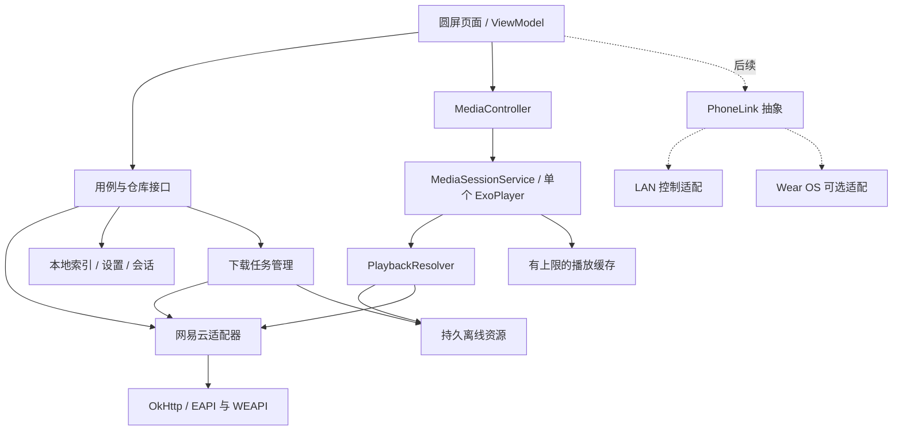

# 技术架构与接口

状态：拟议架构，尚未创建 Gradle 工程或实现任何接口。上游事实参见 [01 项目研究](01-上游项目研究.md)，平台依据参见 [08 来源](08-研究来源与决策记录.md) 中 O01–O05。

## 1. 总体方案

采用普通 Android 应用形态，Kotlin + Compose Foundation/Material3 构建圆屏 UI，Media3 的 ExoPlayer + MediaSessionService 承担音频。首发依赖图不包含 Google Play services；未来 Wear OS 扩展通过单独构建变体和适配层加入。



UI 不持有第二个播放器。所有播放命令进入同一会话，歌曲/队列/播放状态由服务权威维护；页面恢复通过 MediaController 重新连接。

## 2. 未来工程结构

以下为计划中的目录，仅写在文档里，本次不创建这些模块。

```text
MeloX-Watch/
  android/
    app/                 # watchAndroid 主变体；wearOs 后续变体
    core/model/          # 曲目、队列、歌词、错误与能力模型
    core/data/           # HTTP、网易云适配、本地仓库、会话存储
    core/playback/       # Media3 服务、解析、焦点、队列恢复
    core/lyrics/         # 解析与时间线，不依赖页面
    core/download/       # P4 引入：任务、下载缓存、离线索引
  docs/
  research/              # 已有研究资料，不加入产品 Gradle 依赖
```

P1 先落地 app/model/data/playback/lyrics；小型 feature 先按 app 内 package 划分，避免首期拆出大量空模块。播放和数据模块不得依赖 `ui.*`、手机 Activity 或 GMS。`PhoneLink` 可先只保留设计契约，扩展阶段再创建实现。

包名使用独立的开发者命名空间，示例占位为 `dev.example.melox.watch`；正式名称在实施时确认，不能沿用上游包名和签名。普通安卓与 Wear OS 变体若采用不同 applicationId，需要独立配置分发、配套手机应用身份及同步验证。

## 3. 技术选择与冻结点

| 项目 | 规划选择 | 冻结条件 |
| --- | --- | --- |
| Android 下限 | `minSdk 26` 为初始候选 | 实机 API + 依赖要求核验，低于 26 时重新评估 |
| compile/target SDK | 已固定 36，Build Tools 35.0.0 | 由 `.ci/toolchain.properties` 管理；实机行为仍待核验 |
| Gradle/AGP/Kotlin/Compose | Gradle 8.13 / AGP 8.11.1 / Kotlin 与 Compose 编译插件 2.2.21 | 云端唯一编译；Compose UI 等应用依赖在实现时精确锁定，见 09 文档 |
| UI | 普通 Compose + 圆形布局组件 | Watch X2 运行通过后，再评估 Wear Compose 变体 |
| 音频 | Media3，同组组件保持一致版本 | 本地/网络播放、音频焦点与通知通过 |
| 网络 | OkHttp + Coroutines | 超时、取消、重试与序列化测试通过 |
| 数据 | Room 保存队列/索引；DataStore 保存普通设置 | P1 确认兼容版本；Cookie 不以明文写入这些存储 |
| 封面 | Coil 或同等轻量加载器 | 按实际显示尺寸解码，有磁盘/内存上限 |
| 凭证 | Android Keystore 包装密钥 + 加密应用私有存储 | 重启、密钥失效、退出/切账号场景通过 |
| 下载 | 优先 Media3 DownloadManager/DownloadService + 业务索引 | P4 证明签名 URL 刷新、暂停恢复与无淘汰下载缓存可行 |
| Native 依赖 | 首发尽量使用平台解码 | 只有实机出现阻断性格式问题才评估额外解码器和 APK 成本 |

## 4. 模型与接口契约

以下字段是设计契约，不是上游现成 API。由窄接口隔离上游对象与 UI。

| 对象/接口 | 关键内容 | 约束 |
| --- | --- | --- |
| `TrackKey` | `providerId`、字符串 `trackId` | 不用曲名匹配作为主键 |
| `Track` | key、标题、艺人、封面、时长、可用性 | 元数据可显示不意味着可播放 |
| `PlaybackResource` | URL、必要 headers、实际音质、格式、有效期（未知则空） | URL 作为短期资源处理；不永久写入队列 |
| `QueueSnapshot` | schemaVersion、曲目 keys、索引、positionMs、shuffle/repeat、更新时间 | 账号隔离；恢复时重新校验索引和音频资源 |
| `Session` | accountId、有效性、加密凭证引用 | 原始 Cookie 仅在网络边界短暂使用 |
| `LyricsDocument` | 按时间排序的行、可选字词/翻译、来源、偏移 | 所有时间归一为毫秒 |
| `OfflineEntry` | 账户范围、TrackKey、稳定缓存 key、音质、大小、完成状态、歌词引用 | 不以临时 URL 作为唯一标识 |
| `AuthRepository` | 申请二维码、检查状态、校验账号、退出 | 回调带 generation，丢弃过期任务结果 |
| `CatalogRepository` | 搜索、日推、喜欢、歌单、批量歌曲详情 | 分页可取消，有真实 `hasMore` 语义 |
| `PlaybackResolver` | 本地优先，联网时解析可用资源 | 单曲失败不造成无界自动跳歌/重试 |
| `DownloadRepository` | 添加、暂停、恢复、删除、观察任务 | 下载资源权限与播放权限分开判断 |
| `PhoneLink` | capabilities、状态、命令、队列移交 | 可选，不进入独立播放的关键路径 |

错误统一映射为 `LoginRequired`、`NetworkUnavailable`、`RateLimited(retryAfter)`、`ResourceUnavailable`、`UnsupportedFormat`、`StorageFull`、`PermissionDenied`、`Unknown(code)`，页面不直接展示原始响应或包含凭证的请求地址。

## 5. 账号与接口调用

二维码流程：申请 key → 本地生成二维码 → 仅在页面前台且网络可用时轮询 → 收到确认 → 提取会话 → 调用账号接口验证 → 原子保存 → 刷新音乐库。

轮询建议初始 2–3 秒，可根据服务端返回退避；过期后由用户刷新或进行一次有上限的自动更新。离开页面取消任务；对快速刷新后的旧成功响应使用 generation 校验。不能仅因拿到非空 Cookie 就认为账号有效。

| 功能 | 上游可核对的请求/入口 | 计划处理 |
| --- | --- | --- |
| QR key / 状态 | Watch API 中 `/api/login/qrcode/unikey`、`/api/login/qrcode/client/login`；Android 网页桥接 | P0 验证渠道与参数，不混用 type 或 Cookie 语义 |
| 账号 | `NeteaseSearchClient.accountProfile`、Watch API | 存储前校验，明确未登录和过期 |
| 搜索 | `NeteaseSearchClient.searchSongs`；UniversalSearch 仅作其他搜索类型参考 | 新增歌曲 offset/page 契约并验证响应总数/末页；两个现有搜索入口都不能直接提供完整歌曲分页 |
| 喜欢/歌单/日推 | `NeteaseLibraryClient` | 先取摘要；详情分批，不一次请求数千首 |
| 播放 URL | `NeteaseQualityClient` 的 player URL 路线 | 请求前绑定账号；检查空 URL、试听、音质和格式 |
| 下载 URL | `NeteaseQualityClient` 的 download URL 路线 | 验证下载可用性后才创建任务；播放 URL 回退另行决策 |
| 歌词 | `NeteaseSearchClient.lyrics`、Watch API 的 lyric 路线 | MVP 先保证 LRC；AMLL/TTML 为可选后续来源 |

所有接口都是第三方项目已有实现，未在本次在线验证。协议变化风险通过适配器、脱敏响应样本和契约测试控制；不把它们当作音乐平台提供稳定性承诺的公开 API。

退出和切账号需要取消旧请求、清除会话及该账号的 URL 缓存、停用旧账号的下载任务、隔离音乐库。已下载内容是否删除由明确的本地操作控制，不能让另一个账号自动继承其资源访问状态。Keystore 不可用时应提示会话无法持久化或要求重登，不降级到明文凭证。

## 6. 播放与后台服务

1. 用户在前台选择曲目，UI 发出播放命令，服务建立/更新队列。
2. 优先检查完整可用的本地下载；否则解析短期播放 URL 并交给 ExoPlayer。
3. 缓存 key 包含 provider、曲目、音质与必要账号范围，避免 URL 换签后重复缓存或串号。
4. 使用音频焦点与耳机断开处理，支持媒体按钮；正在播放时发布媒体通知。
5. 曲目、模式、队列改变时持久化；播放位置按有上限的间隔保存，暂停/跳转时立即更新。不能只依赖 `onDestroy`。
6. 进程恢复后装载快照并等待用户恢复，重新解析过期 URL；网络恢复不会触发意外外放。

规划使用 `FOREGROUND_SERVICE`、适用系统上的 `FOREGROUND_SERVICE_MEDIA_PLAYBACK` 以及 `foregroundServiceType="mediaPlayback"`，依据 O01；前台服务从用户可见的操作发起，按目标 API 检查后台启动约束。普通应用无法保证在用户强制停止后继续播放，不把该场景设计成自动拉起。

权限按能力申请：网络状态为基础；Android 13+ 的通知权限行为需要实测，包括拒绝后的媒体会话表现；只有主动调用需要权限的蓝牙查询/连接 API 时才考虑 `BLUETOOTH_CONNECT`。系统音频路由播放不等同于必须申请蓝牙扫描。下载保存到应用私有目录，首发无需为整个共享存储申请广泛访问权限。

首发一个 ExoPlayer，不做 AutoMix 双播放器预载。屏幕不可见时停止封面动画、歌词滚动和 UI 高频计时，保留音频服务所需逻辑。CPU 唤醒锁应由实际播放需要控制，不能常驻持有。

## 7. 下载、缓存与离线一致性

流式缓存可按 LRU 淘汰；用户下载使用独立的无自动淘汰缓存和下载索引。Media3 下载服务、管理器及下载缓存的职责依据 O02，业务层仍需补充账号、实际音质、URL 更新和错误映射。

任务状态拟为：`Queued → Resolving → Downloading → Verifying → Completed`；旁路状态为 `Paused / WaitingForNetwork / WaitingForSpace / Failed / Removing`。数据库的 Completed 必须在音频完整性检查成功之后提交。歌词下载失败不伪装成音频失败，应单独显示“音频完成，歌词不可用”。

持久化稳定任务 ID、曲目 ID、账号范围、质量、下载索引关联和更新时间。重启后对下载索引、业务状态和缓存内容做协调，处理中断写入及半完成状态。Range 恢复只有在服务端支持且内容身份一致时使用；URL 过期先重新解析，内容变化则重新下载，不把不同版本字节拼接。

下载默认并发 1，Wi-Fi 优先，可显式允许其他网络；弱网播放缓冲时降低下载竞争。服务类型按适用版本使用 dataSync，并遵守其运行时限；长期暂停任务交给约束调度恢复，不让播放器服务永久承担下载保活。WorkManager 如使用，仅做调度/清理，不作为音频引擎。

## 8. 手机协同与 Wear OS 扩展

现有 LAN v1 使用 UDP 发现、TCP 行式 JSON、PIN 和设备信任列表，支持 `state/control/transfer` 等；协议说明设备 ID 不是密码学身份，也未定义账号 Cookie 同步。[A10] 第一轮扩展只验证现有播放器控制与曲目移交，默认关闭发现，用户进入连接页才启用。广播失败可选择手动地址；手机与手表必须真正处于可互访的网络。

账号同步单独立项：短期一次性配对、用户可核对身份、加密且认证的通道、最小凭证传输、撤销和重放防护；需要手机端新增实现。不能把 Cookie 放进原有明文 LAN 消息，更不能把 Apple WCSession 模型直接视为 Android 传输方案。

Wear OS 变体在扩展阶段验证 `android.hardware.type.watch` 声明、独立应用元数据、返回/表冠行为和分发要求。Data Layer 仅在实际支持的设备与手机组合中作为可选通道，账户/音乐请求继续直接联网；Google 文档对其设备范围和网络用途有明确限制。[O03][O04] Tiles/Complications 不属于兼容第一步。

## 9. 代码来源与维护

每个提取文件记录上游路径、提交、修改理由和验证用例；先提取边界最小的一组代码，再运行接口和模型测试。上游更新按具体变更审查，不自动合并整个手机应用。

在 P1 冻结依赖清单、P2 冻结账号/音乐接口、P4 冻结离线状态协议、P5 冻结发布构建。任何一个冻结点发生变更，都要重新评估其直接影响的验收用例。
