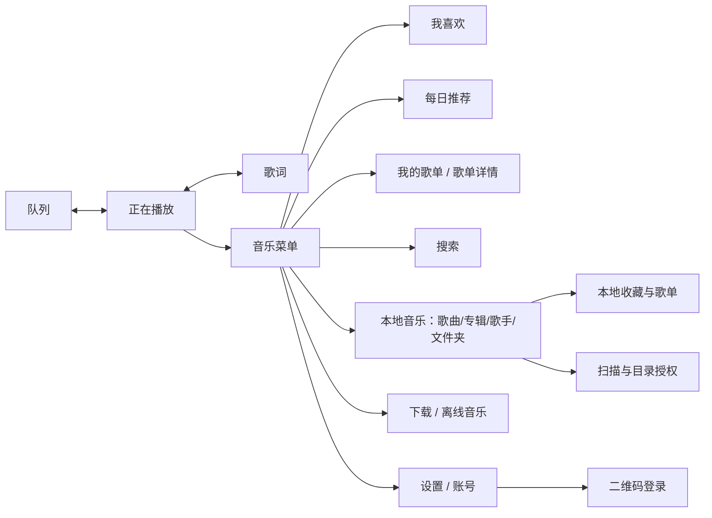

# 手表交互、圆屏与方屏适配

状态：界面规划，尚未制作或运行UI。产品面向无GMS硬依赖的普通Android智能手表，支持按运行时圆形、方形/矩形窗口适配；Watch X2只是当前可用的主测试设备，不是唯一支持型号。尺寸是初始值，以各设备实际窗口、字体和能力为准；Wear OS专项整合仍在后续阶段。

产品优先级为性能第一、界面美观第二、可读性必须达标。初始视觉 token、布局与状态验收见 [15 界面规范](15-界面设计与视觉验收.md)，性能阈值唯一引用 [14 性能预算](14-性能优先与资源预算.md)。首个完整公开版本必须交付 [21 全量需求整合](21-本地播放器全量需求整合.md) 的全部128项（含原13项待定），行为原文见 [匿名需求基线](requirements/local-player-F001-F128.md)，主责LP与256个AC见 [覆盖矩阵](requirements/local-player-coverage.json)。参数待选、设备待测不改变必做范围；本地详细行为见 [17](17-本地音乐功能与实施计划.md)。

## 1. 页面结构

主界面采用队列、正在播放、歌词三页结构，默认打开正在播放页。主入口放在窗口可触达区域，圆屏优先中央；菜单与详情使用单独页面，不照搬手机底部导航栏。

内部阶段按实际完成情况展示入口；未实现项保留在必做计划并阻断完整公开版本验收。在线持久下载仍按P4单列。本地音乐入口从首版就存在，未登录或无互联网时能完整浏览和播放；仅在线功能提示登录，不以全屏登录页挡住本地入口。

## 2. 运行时形状与窗口约束

- 依据运行时窗口宽高、inset和可信形状信息布局，不按机型名、地区SKU或白名单猜密度/系统。只有`isRound`为真或经实测确认圆形时使用圆形避让；信息未知时记录并核验，不能无条件套圆形裁切。
- 圆屏的关键操作优先中央，端部内容保留滚动留白；方形/矩形窗口按可用矩形与inset布局，利用边角空间，不套圆形弦宽或强行切掉四角。窗口变化时重新布局。
- 圆形公式仅作可选布局辅助；按实际控件热区、文字和焦点环检查与系统可用窗口的交集。不要用整行外接矩形代替各控件几何，或仅凭其超界就移走实际放得下的功能；示例见15。
- 独立触控目标至少 48×48dp，播放/暂停主按钮建议56dp；热区无重叠。只有实际控件与文字无法容纳时才改布局或移动次级操作，不缩小48dp底线。
- 模拟起步取192/260dp圆形窗口与1.0/2.0字体的代表组合，按15抽样共用布局；不是每页每PR穷举矩阵，也不是Watch X2实际dp断言。另测方形/矩形窗口的代表布局。真表以实际窗口和默认/最大支持字体验完整路径，各设备结论分开。
- 系统边缘返回手势留有空间；横向分页从内容区域发起。列表首尾留白允许最后一项滚动到中心。

## 3. 页面设计

| 页面 | 必需内容 | 操作与异常 |
| --- | --- | --- |
| 正在播放 | 静态封面、歌名/艺人、播放状态、三键控制、进度概要 | 点击主键暂停；更多菜单包含音量/进度/模式；无歌曲时进入音乐菜单 |
| 队列 | 当前项、接下来的歌曲、播放模式入口 | 按实例ID点选；完整队列存数据库、视窗分页；支持上移/下移/移至位置和保存/取消，拖动仅增强 |
| 歌词 | 原文、可用译文、真实行/字时间与来源 | 手动浏览不抢滚动；回到当前重新锚定；纯文本不伪同步；“从此处播放”与浏览明确分开，可能从暂停发声须有提示 |
| 音乐菜单 | 本地音乐、喜欢、日推、歌单、搜索、阶段内下载、设置 | 每行一个任务，最多两行文字；滚动位置在返回时保留 |
| 歌单列表/详情 | 摘要、名称、歌曲数；详情按批加载 | 首屏即可开始播放；末尾显式显示加载/重试/结束 |
| 搜索 | 输入入口、查询文本、结果列表 | 使用可用系统输入法；输入法不可用时给出可理解状态；不把语音/GMS 当默认输入方式 |
| 本地音乐 | 歌曲、专辑、歌手、文件夹、搜索与排序入口 | 分类使用分步列表，不堆在一个小窗口；索引读取不等待重新扫描，不访问在线服务 |
| 本地收藏/歌单 | 本地收藏、自建歌单、曲目管理 | 首版支持本地歌单增删改与调整顺序；不等同于网易云歌单写入，也不要求拖动操作 |
| 扫描与授权 | 已授权来源、进度、取消、结果和失败项 | 拒绝/撤销、后台暂停、用户取消、部分完成、失败和空目录分别呈现；保留原索引，按17重新授权或重扫 |
| 二维码 | 高对比二维码、简短状态、刷新/退出 | 二维码和完整静区放入实际可用区域；圆屏才计算圆内方形，方屏利用矩形窗口，均需真实扫码 |
| 下载 | 已完成与任务入口、空间概要 | 暂停/继续/删除通过简短操作页；失败显示可重试原因 |
| 设置 | 账号、后端、音效、扫描、外观、歌词、备份、语言、帮助 | 预览/已保存/实际生效值分开；重置只重置偏好，不清库、不自动启网或发声 |
| 自定义解析服务 | 用户 API 地址/模板、启停、测试、删除配置 | 默认关闭/空地址；支持自建，测试结果分阶段；脱敏展示，关闭不删曲目/本地库，详见 19 |

歌名默认两行内换行或截断，完整名称可在详情查看；按 15 文档统一默认关闭自动跑马灯。中文、英文、长歌名、emoji 和字体放大均需覆盖。缺文件、无权限、封面缺失或 LRC 异常分别有稳定状态，不显示旧曲信息掩盖问题。

## 4. 表冠和实体按键

P0 先记录实机是否向普通应用发送标准旋转输入和可用按键事件。若发送 `SOURCE_ROTARY_ENCODER` 等标准事件，可用于当前列表滚动；若系统拦截，则所有功能仍能用触控完成。

F-082提供启停、进度/系统媒体音量目标和正反方向设置；默认列表页仍滚动，播放页仅在用户明确启用且焦点匹配时处理映射。步长、去抖与连续输入上限按07探针确定并显示；无表冠保留触控替代。F-083触觉独立开关，只反馈有效离散步进，关闭后无应用触觉请求。系统 Home/返回/快捷键不进行隐藏拦截，不依赖厂商私有协议。

F-033耳机媒体键进入唯一MediaSession，提供应用响应启停偏好；关闭不改系统配对。焦点偏好默认启用，输出安全始终生效。系统音量F-076与应用声道增益F-077分开显示，禁止把一个滑杆同时写入两者。蓝牙歌词F-084有独立隐私开关、兼容接收端及连接状态；协议未探明显示待验证，不能把普通标题字段当已完成歌词传输。

## 5. 状态与反馈

每个联网列表都具有首次加载、已有缓存刷新、空列表、无网络、登录过期、可重试错误和分页结束状态。已有数据刷新失败时保留内容并提示，不清空整个页面。

播放页区分“正在解析”“正在缓冲”“已暂停”“不可播放”。换歌时立刻更新目标曲目，旧请求不能在稍后抢回界面。限制连续自动跳过次数，失败过多则停下并提示。

控制反馈优先使用按钮状态和简短文字；触觉可选且低频。不要让常规切歌弹出阻断对话框。耳机断开后的暂停应标明原因。

## 6. 省电和可访问性

纯黑背景、静态封面、简洁高对比图标为默认。前台进度摘要可每秒更新；只有用户查看歌词时运行歌词跟随。后台通过生命周期停止 UI 更新，播放器时间来自唯一会话当前活动后端。Media3 ExoPlayer与系统MediaPlayer都提供选择；切换保存曲目/队列/位置后暂停、释放旧后端、建立新后端并恢复暂停态。失败时释放失败实例，再重建旧后端及效果；回退也失败则保留可恢复快照与明确错误，不自动发声。

F-103默认关闭，用户启用后仅当前可见歌词页可保持屏幕亮起；离页、后台、锁屏、播放结束、页面销毁或异常退出都解除，不能靠常亮维持后台音频。默认静态并保留F-099五种背景；封面模糊只在图像/尺寸/强度变化时离屏生成并缓存，静态流体不持续动画。逐字强调只消费真实字时间，可关闭动效；隐藏页面停止视觉采样，显式启用的F-084外部歌词按独立有界会话调度。系统限制如实记录，不以默认省电删除这些能力。

按钮提供语义标签、选中状态和可访问名称，文字不能只靠颜色区分。字体放大时可转为单列或分步操作，保持主控制可点击。自适应布局依据 O05，圆形几何和交互取舍为本计划的具体设计。

## 7. 全量功能的交互约束

| 功能与LP | 必需入口、正常行为及取消/失败 |
| --- | --- |
| F-079–081、086、127 / LP-04 | 点歌支持每次询问、插入后播放、当前列表建队列；替换队列前显示范围和起点。播放全部冻结完整筛选/排序结果，跨页且超过10000条也完整，失败保留旧队列。有限循环显示计数；是否包含首次、seek与恢复规则由17冻结；随机单曲与普通随机区别可读。快捷菜单复用同一动作，不保存第二播放状态。 |
| F-057/058/076/077/123 / LP-06 | 系统媒体音量以当前路由实际值为准；应用左右声道分别预览/保存/复位。EQ显示实际频段、预设和可命名配置；ReplayGain显示曲目/专辑与缺标签状态；压限器显示实际生效通路。不可用组合说明原因并允许回到可用配置，不能静默忽略设置或只保存空开关。 |
| F-053/063/075/088 / LP-10 | “移出索引”“删除导入副本”“删除原文件”“编辑文件标签”“重命名/移动”分别命名。多选跨页固定ID和数量；确认目标与不可逆影响，必要系统确认仍须完成。确认前取消不改文件；执行中取消停止后续项，已完成动作不伪称撤销，逐项列成功/失败/未执行，重试不扩大选择。标签别名与真正写回、同提供方移动与复制校验后删除源分开。 |
| F-051/068/069/094/095 / LP-09/11 | M3U、JSON歌单与全应用备份分开。先校验预览可匹配/缺失/冲突和合并/替换影响，再提交；不能把URI文本当授权。失败保留旧库/歌单，未完成导出不标成功；默认备份不含音频、凭据和配对秘密。 |
| F-066 / LP-13 | 用户开启限时接收，显示当前目标、认证、剩余会话状态、真实字节进度与关闭入口。关闭后立即停止接收；断网/低空间/重名/重复上传不覆盖原件，完整校验后才入库。 |
| F-067/097/124–126 / LP-14 | 真实手机配套应用支持传歌、曲库分页、歌单编辑、专辑/歌手信息和主题编辑上传。首版计划采用原生Android配套端，API/实际测试手机在LP-14冻结，分发与手表共用项目Release渠道（09/10）；不预建其他手机平台。网页可辅助F-066，不能替代F-067所需额外应用。双方明确目标；只读曲库、上传、歌单写、元数据写、主题上传分别授权。过期/撤配对停止访问；revision冲突保留草稿并选择处理；重试用同一幂等ID。手表确认主题应用，别名编辑不冒充F-063原标签写回。 |
| F-089–093、085/087/104 / LP-02/03/09 | 扫描过滤/排除只改变候选或可见性，不删除原件及用户关系；60秒是源阈值候选，可编辑性待定。文件夹歌单自动成员与手工顺序覆盖分开，失败扫描不清成员；路径关键词生成普通歌单快照。自然文件名/播放次数排序、字母定位、统计和网格/列表均真实可用，未知值不填假零。 |
| F-065/096/098–100、102/105–107/117 / LP-12 | 主题、图片、形状、缩放、边距均先预览再保存，可恢复默认且保留最小热区/系统inset。支持自动/圆/矩形；标题精简仅显示层，详情保留全名。主题校验无脚本/路径逃逸，失败用上个可用主题。所有加载、空、错误、部分结果、禁用与帮助状态有简中/英文。 |
| F-108–116/128 / LP-07 | 字号、行距、对齐、锚点、边距与原文/译文字体分别设置；TTF/OTF和wght范围验证，损坏/缺字/撤权安全回退。翻译来源明确，不自动联网翻译；字时间缺失回到逐行。时间行“从此处播放”确认方式经圆屏误触探针确定，保持能力；切歌旧动作失效，seek使用与显示同一偏移时基并服从焦点/路由。 |
| F-064/122 / LP-08 | 到期立即暂停或等当前曲结束；等待模式手动暂停/切歌取消本次定时。摘要开关只影响通知，不取消定时；重建/重复设置只留一个有效截止任务。 |
| F-070/071/118–121 / LP-07/15 | 联网歌词/封面仅用户请求、最少字段、预览确认后关联；查更新不自动下载安装。隐私/许可/帮助离线可读，支持渠道由本产品所有者确认，诊断显式导出不自动发送；引导可退出与重入，不强制联网或接受可选功能。 |

所有预览取消恢复进入前值，保存失败显示真实生效值并保留草稿/重试；语言切换和重建不重放播放、删除、上传或确认事件。外观组合需在真实圆屏验证，不能只检查单个滑杆。

## 8. 设计验收材料

完整公开版本前，在当前主测Watch X2的默认和系统最大支持字体下完成在线、本地及适用的全量功能路径，附长文本、扫码、边缘操作、后台恢复和Meting状态证据。后续PR只复核受影响页面/状态；共享布局变化再扩大覆盖，详见15。使用 [界面验收记录](templates/界面验收记录.md)，与实际发行APK及性能报告关联；profileable诊断包按09/14单独标识，不能冒充相同APK。方/矩形窗口的代表验证也必须记录；模拟图不能替代相应真实设备结果，不把当前主测通过泛化为所有手表通过。

每项必做功能必须在声明支持的设备/后端/配套端组合完成正常路径，并覆盖异常路径；主测设备缺能力时保留受限记录，补充兼容设备/接收端证据。全局只有禁用提示不算通过。精确F/AC映射以21和覆盖矩阵为准，本页交互分组不替代原128项规格。
