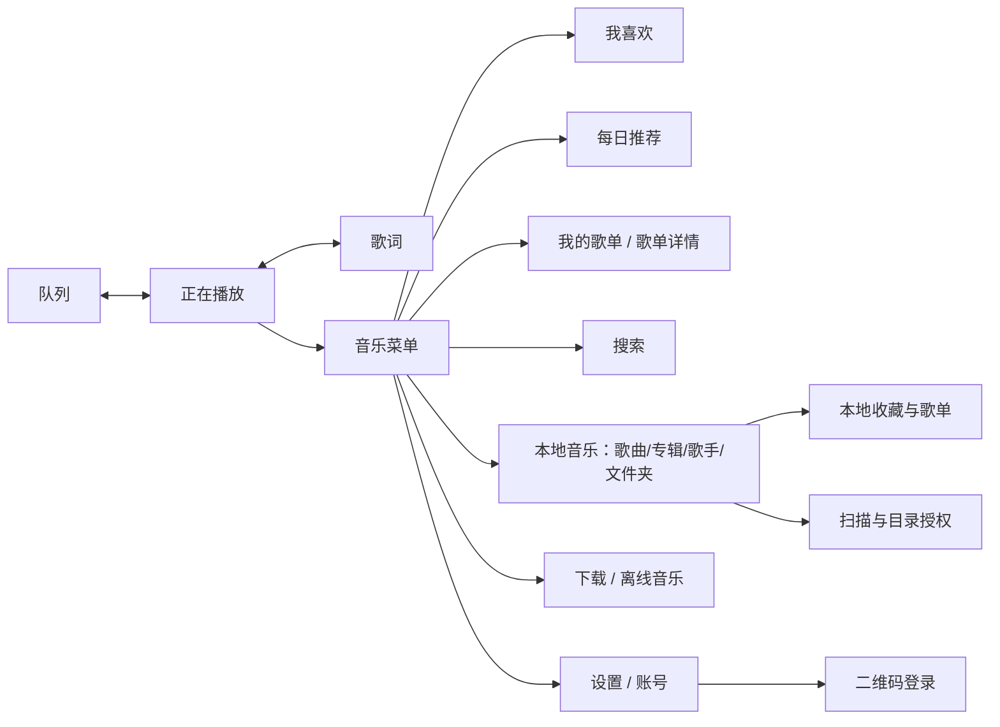

# 圆屏交互与适配

状态：界面规划，尚未制作或运行 UI。以下尺寸是初始设计值，最终以 Watch X2 的实际 dp、字体比例和窗口边界为准。

产品优先级为性能第一、界面美观第二、可读性必须达标。具体视觉 token、布局与状态验收见 [15 界面规范](15-界面设计与视觉验收.md)，性能阈值唯一引用 [14 性能预算](14-性能优先与资源预算.md)。本地音乐现已纳入首版，详见 [17 本地音乐](17-本地音乐功能与实施计划.md)。

## 1. 页面结构

主界面参考原项目 Apple Watch 的三页结构 [B02]，默认打开正在播放页。主入口放在圆屏中间可点击区域，菜单与内容详情使用单独页面，不照搬手机底部导航栏。

MVP 菜单隐藏尚未实现的在线下载功能；1.0 开启下载入口。本地音乐入口从首版就存在，未登录或无互联网时能完整浏览和播放；仅在线功能提示登录，不以全屏登录页挡住本地入口。

## 2. 圆形屏幕的约束

- 使用窗口当前宽高和系统 inset 计算布局，不写死物理像素分辨率或密度。圆角/圆屏信息不可靠时，以目标设备配置和可校验的几何策略补充。
- 核心文字和交互优先落在中央安全区；列表可利用更宽的中段，但顶部/底部行要收窄并保留滚动留白。
- 圆半径为 `r`、屏幕中心为 `(cx, cy)` 时，行纵坐标 `y` 的左右几何边界可按 `cx ± sqrt(r² - (y-cy)²)` 求得，再扣除触控和视觉边距。实际还应取系统可用窗口与此区域的交集。
- 初始触控目标至少 48dp，播放/暂停主按钮建议 56dp；相邻区域保持间隔。若实测空间不足，移走次级操作，不缩小点击区域。
- 起步按约 192–260dp 的内容宽度做模拟覆盖，这只是测试包络，不是对 Watch X2 实际 dp 的断言。实机测得范围不同则补充布局样例。
- 系统边缘返回手势留有空间；横向分页从内容区域发起。列表首尾留白允许最后一项滚动到中心。

## 3. 页面设计

| 页面 | 必需内容 | 操作与异常 |
| --- | --- | --- |
| 正在播放 | 静态封面、歌名/艺人、播放状态、三键控制、进度概要 | 点击主键暂停；更多菜单包含音量/进度/模式；无歌曲时进入音乐菜单 |
| 队列 | 当前项、接下来的歌曲、播放模式入口 | 点击切歌；显示正在播放标记；大队列懒加载；首发不做拖动排序 |
| 歌词 | 当前行、上下文，保持中心可读 | 手动滚动后暂停自动跟随；提供“回到当前”；无歌词显示稳定空态 |
| 音乐菜单 | 喜欢、日推、歌单、搜索、下载、设置 | 每行一个任务，最多两行文字；滚动位置在返回时保留 |
| 歌单列表/详情 | 摘要、名称、歌曲数；详情按批加载 | 首屏即可开始播放；末尾显式显示加载/重试/结束 |
| 搜索 | 输入入口、查询文本、结果列表 | 使用可用系统输入法；输入法不可用时给出可理解状态；不把语音/GMS 当默认输入方式 |
| 本地音乐 | 歌曲、专辑、歌手、文件夹、搜索与排序入口 | 分类使用分步列表，不堆在一个圆屏；索引读取不等待重新扫描，不访问在线服务 |
| 本地收藏/歌单 | 本地收藏、自建歌单、曲目管理 | 首版支持本地歌单增删改与调整顺序；不等同于网易云歌单写入，也不要求拖动操作 |
| 扫描与授权 | 已授权来源、进度、取消、结果和失败项 | 权限撤销、扫描失败和空目录分别呈现；失败不清空原索引；重新授权后恢复 |
| 二维码 | 高对比二维码、简短状态、刷新/退出 | 二维码和完整静区放在圆内方形区域；保留扫描所需可见尺寸 |
| 下载 | 已完成与任务入口、空间概要 | 暂停/继续/删除通过简短操作页；失败显示可重试原因 |
| 设置 | 账号、音质、缓存/下载、版本/诊断 | 设置值即时可见；需重登/需联网的操作说明其效果 |

歌名默认两行内换行或截断，完整名称可在详情查看；按 15 文档统一默认关闭自动跑马灯。中文、英文、长歌名、emoji 和字体放大均需覆盖。缺文件、无权限、封面缺失或 LRC 异常分别有稳定状态，不显示旧曲信息掩盖问题。

## 4. 表冠和实体按键

P0 先记录实机是否向普通应用发送标准旋转输入和可用按键事件。若发送 `SOURCE_ROTARY_ENCODER` 等标准事件，可用于当前列表滚动；若系统拦截，则所有功能仍能用触控完成。

避免全局“转表冠就调音量”：在列表页旋转负责滚动，在明确进入的音量页才调整音量；播放页是否启用旋转控制等实测后决定。系统 Home/返回/快捷键不进行隐藏拦截，不依赖厂商私有协议。

蓝牙耳机媒体键通过 MediaSession 处理，不能只在 Activity 的按键回调中实现。

## 5. 状态与反馈

每个联网列表都具有首次加载、已有缓存刷新、空列表、无网络、登录过期、可重试错误和分页结束状态。已有数据刷新失败时保留内容并提示，不清空整个页面。

播放页区分“正在解析”“正在缓冲”“已暂停”“不可播放”。换歌时立刻更新目标曲目，旧请求不能在稍后抢回界面。限制连续自动跳过次数，失败过多则停下并提示。

控制反馈优先使用按钮状态和简短文字；触觉可选且低频。不要让常规切歌弹出阻断对话框。耳机断开后的暂停应标明原因。

## 6. 省电和可访问性

纯黑背景、静态封面、简洁高对比图标为默认。前台进度摘要可每秒更新；只有用户查看歌词时运行歌词跟随。后台通过生命周期停止 UI 更新，播放器时间仍来自 Media3。

首发不主动申请常亮，不将歌词常驻到系统息屏界面；设备省电模式下是否能继续音频由 P0/P5 实测确认。若厂商模式停止第三方应用，应在结果记录中明确支持范围。

按钮提供语义标签、选中状态和可访问名称，文字不能只靠颜色区分。字体放大时可转为单列或分步操作，保持主控制可点击。自适应布局依据 O05，圆形几何和交互取舍为本计划的具体设计。

## 7. 设计验收材料

未来 P3 应交付：实际 Watch X2 截图、各主要页面的长文本/大字体样例、二维码扫码录像或记录、边缘触控覆盖记录，以及在线登录到播放、本地无账号无互联网播放、后台恢复的完整路径。使用 [界面验收记录](templates/界面验收记录.md)，与性能报告绑定相同云端产物。不要用手机模拟图代替圆表验收。
