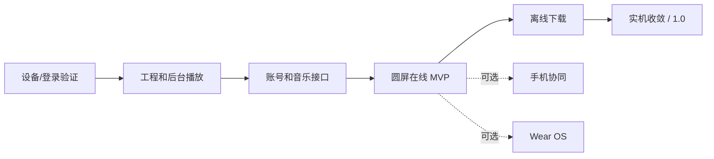

# 开发阶段与任务清单

**所有应用开发任务均未开始。** 已完成计划和上游研究，并在单独落地仓库治理与云端构建基础设施；这不代表 P0 设备验证通过。以下应用阶段只有在后续进入实施时执行。

## 1. 估算与依赖

估算假设：1 名熟悉 Kotlin、Compose、Media3 的开发者；每周 5 个工作日；可使用 Watch X2、蓝牙耳机、Wi-Fi 和测试账号；仅接网易云；首发没有手机伴侣和重型动效。人日包含本阶段实现及必要验证，不包括等待设备/账号/平台接口恢复的时间。

| 阶段 | 内容 | 工作量 | 前置条件 | 交付/退出门槛 |
| --- | --- | --- | --- | --- |
| P0 | 实机与关键技术验证 | 3–4 人日 | 获准开始实施且设备可用 | 设备能力表；APK 路径和登录方向可行；最小后台音频验证 |
| P1 | 精简工程与播放基础 | 6–8 人日 | P0 通过 | 可安装开发包；单播放器、媒体会话、基本控制和队列恢复 |
| P2 | 账号、网易云与音乐库 | 7–10 人日 | P1；P0 登录结论 | 真实登录→列表→播放闭环；分页、错误和会话隔离通过 |
| P3 | 完整圆屏 MVP 与歌词 | 6–8 人日 | P2 | Watch X2 在线 MVP，核心流程可用、熄屏验证通过 |
| P4 | 持久下载与离线库 | 7–10 人日 | P3；下载接口验证 | 断网可播，下载任务和存储状态可恢复 |
| P5 | 性能、兼容与发布候选 | 6–8 人日 | P4 | 1.0 候选版、完整实机报告、可复现签名构建 |
| P6（可选） | LAN 手机控制/移交 | 4–6 人日 | P3+；手机端协议可互通 | 明确播放目标，断连可恢复；不包含账号同步 |
| P7（可选） | Wear OS 兼容 | 5–8 人日 | P3+；Wear OS 测试设备 | 独立播放与主要界面通过专用验收 |

P0–P3 合计 22–30 人日，约 4.5–6 周；P0–P5 合计 35–48 人日，约 7–10 周。P6/P7 不在该主线估算内。若开始正式排期，应在 P0 后保留约 20% 风险余量，主要应对 OEM 后台策略和第三方登录接口。

## 2. P0：先消除阻断风险

| ID | 任务 | 交付及验收 |
| --- | --- | --- |
| DEV-001 | 填写 Watch X2 能力表 | 型号/SKU、API、ABI、屏幕 dp、安装方式、WebView、Google 服务、联网和表冠均有记录；未知项标明原因 |
| DEV-002 | 验证普通应用安装及后台音频 | 使用后续专门准备的最小样例，验证启动器可见、耳机输出、退后台/熄屏连续播放至少 30 分钟；记录设置条件 |
| DEV-003 | 比较扫码登录路径 | 核对原生 EAPI 与必要时 WebView 桥接；验证二维码、过期、确认及 Cookie 账号校验；输出选择或阻断结论 |
| DEV-004 | 核验初始构建与性能基线 | 使用已锁定云端工具链，应用依赖精确锁定；云端生成样例 APK，本地记录启动/内存/耗电；不在本地编译 |

停止条件：无法安装、无法获得合法可用的网络/音频权限、普通应用无法稳定后台播放，或所有独立登录路径都失败。此时先调整产品路径与估算；不要继续堆叠完整业务界面。手机辅助登录只作为需要重新评估的新范围。

## 3. P1：播放基础

| ID | 任务 | 依赖 | 完成定义 |
| --- | --- | --- | --- |
| DEV-101 | 创建最小模块、版本锁和构建检查 | DEV-004 | app 与 core 边界成立；独立包名；普通安卓变体无 GMS 传递依赖；调试/候选构建明确 |
| DEV-102 | MediaSessionService + 单 ExoPlayer | DEV-101 | 本地合法测试音频可播；控制器重连不产生第二个播放器；Activity 退出不断播 |
| DEV-103 | 焦点、路由、媒体按钮和通知 | DEV-102 | 抢占/恢复策略、耳机断开暂停、系统控制通过；按 API 正确声明前台服务 |
| DEV-104 | 队列和会话恢复 | DEV-102 | 上下曲/随机/循环/seek 正确；进程结束后恢复位置和模式，默认暂停 |
| DEV-105 | 最小圆屏播放 UI | DEV-102 | 触控目标达标，按钮不被圆边裁切，加载/暂停状态清晰 |

本阶段先使用已授权测试音频，避免网络接口失效掩盖播放器问题。此处是未来验证策略，本次未准备或运行样例。

## 4. P2：在线业务闭环

| ID | 任务 | 依赖 | 完成定义 |
| --- | --- | --- | --- |
| DEV-201 | 记录最小上游代码迁移清单 | DEV-101 | 每个提取文件有来源提交、依赖、修改点；无手机 UI、插件、厂商通知反向依赖 |
| DEV-202 | 会话仓库与扫码状态机 | DEV-003、DEV-201 | 成功后校验并加密持久化；退出/重登/账号切换；旧轮询结果不能覆盖新会话 |
| DEV-203 | HTTP 与播放资源解析 | DEV-201、DEV-202 | 超时、取消、限流、过期 URL、不可播放/试听、音质降级有明确错误和测试 |
| DEV-204 | 歌单、喜欢、日推、详情与缓存 | DEV-202 | 先首屏、后分批；数据按账号隔离；缓存刷新失败仍可显示旧列表 |
| DEV-205 | 搜索与真实分页 | DEV-203 | 输入可用；取消过时请求；翻到第二页和末页；正确去重及结束判断 |
| DEV-206 | 在线播放串联 | DEV-103、DEV-104、DEV-203–205 | 实机扫码→选歌→出声→切歌→熄屏；手机离线后仍能在手表可用网络下工作 |

## 5. P3：圆屏在线 MVP

| ID | 任务 | 依赖 | 完成定义 |
| --- | --- | --- | --- |
| DEV-301 | 三页主界面和菜单/详情 | DEV-105、DEV-204 | 导航、系统返回、横向分页无冲突；返回列表保持位置 |
| DEV-302 | LRC 解析、跟随与缓存 | DEV-203 | 切歌隔离；seek 后重新定位；缺失/异常歌词不影响音频 |
| DEV-303 | 表冠、字体和圆屏边界 | DEV-001、DEV-301 | 支持实际事件或明确触控降级；长文本/大字体/二维码可用 |
| DEV-304 | 前后台与失败状态收敛 | DEV-206、DEV-302 | 熄屏停止 UI 更新；断网/过期/无资源/弱网状态清晰；重试有上限 |
| DEV-305 | 在线 MVP 验收 | DEV-301–304 | FR-01–08 和 FR-12 的基础部分通过；实机在线熄屏 60 分钟测试有记录 |

交付：内部在线 MVP APK、设备配置、已知问题、接口风险和测试报告。开发包与可公开发布包区分；本次不生成这些产物。

## 6. P4：离线 1.0 能力

| ID | 任务 | 依赖 | 完成定义 |
| --- | --- | --- | --- |
| DEV-401 | 下载接口与可用性验证 | DEV-203 | 单独定义下载权限、实际音质和回退政策；无资源时不创建假完成任务 |
| DEV-402 | 持久下载任务与服务 | DEV-401 | 并发 1；Wi-Fi 约束；暂停/恢复；进程结束后索引和任务一致 |
| DEV-403 | URL 续期、完整性和空间处理 | DEV-402 | 过期续签、Range/不支持 Range、断电式中断、低空间、重复任务均有稳定结果 |
| DEV-404 | 下载库和纯离线解析 | DEV-402–403 | 飞行/断网下可选歌并播放；下载缺失有修复入口；已缓存封面/歌词可显示 |
| DEV-405 | 缓存、下载删除与账号隔离 | DEV-404 | 清缓存不删持久下载；任务删除与文件/索引协调；切账号不串数据 |

## 7. P5：发布候选

| ID | 任务 | 依赖 | 完成定义 |
| --- | --- | --- | --- |
| DEV-501 | 实机性能和耗电测试 | P4 | 按 06 文档记录数据、条件、样本量和失败项；显著回归有修复或明确范围限制 |
| DEV-502 | 崩溃、恢复与升级回归 | P4 | 无已知阻断崩溃；数据库升级/回退策略明确；不会因升级丢失凭证或下载索引 |
| DEV-503 | 权限和异常设备行为 | P4 | 通知拒绝、系统回收、低电模式、网络切换、耳机断连有记录；明确厂商限制 |
| DEV-504 | 来源、资源与构建产物整理 | DEV-201 | 代码来源、依赖许可、独立资源说明、版本号、独立签名配置和构建步骤齐全 |
| DEV-505 | 1.0 候选验收 | DEV-501–504 | FR-01–12 通过；设备适用范围公开；无阻断性数据丢失和后台播放问题 |

实际发布、上传商店或修改上游仓库不属于本次规划任务。未来 P5 产物可先供本地审阅与安装验收。

## 8. 可选扩展

| ID | 任务 | 工作边界 |
| --- | --- | --- |
| DEV-601 | LAN 发现、连接和控制 | 验证 UDP/TCP 可达；仅用户启动发现；状态和错误一致 |
| DEV-602 | 队列移交和目标切换 | 支持的 provider 才接收；接收端重新解析音源；避免两端同时误播 |
| DEV-603 | LAN 异常测试 | 手机不在线、广播受限、重连、版本不支持；不增加凭证同步 |
| DEV-701 | Wear OS 变体配置 | manifest、独立性声明、专用系统行为；主变体保持无 GMS |
| DEV-702 | Wear OS 输入与界面 | 圆屏、旋转、返回、通知和耳机控制 |
| DEV-703 | Wear OS 独立功能验收 | 无伴侣可完成核心流程；若做 Data Layer，另验证配对/包名/签名条件 |

安全账号同步、额外音源、逐字特效、Tiles/Complications 和手机输入桥接均需新增任务与估算。

## 9. 里程碑记录模板

每阶段结束记录：代码提交、依赖版本、目标固件、完成 ID、测试证据、未完成项、已知限制、是否通过退出门槛、下一阶段估算调整。未通过门槛的阶段不标记完成；不能以功能演示视频替代后台稳定性和状态恢复记录。
