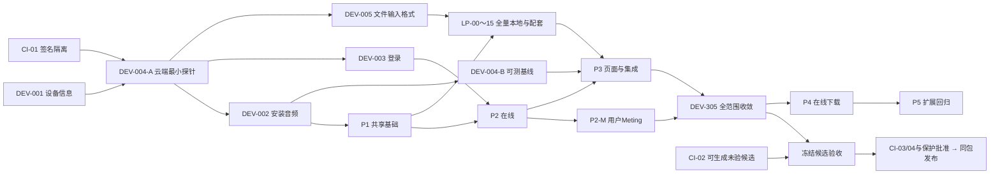

# 开发阶段与任务清单

**用户已恢复完整建设并委托中间开发/审阅，DEV-004-A、P1、LP-01～05及LP-09正在实施。** 用户授权的测试虚拟机已读到API32、主ABI x86_64、466×466/density310及矩形配置；较早P1云端APK已安装并核对身份，音频和本次整合界面尚未验收，交付前再用Watch X2真机验证。LP-00～15及后续应用阶段尚未验收，256个原AC均未通过。本文件只维护范围、依赖、交付物、验收和实际状态，不做工期、人日、代码量或工作量估算。精确进展记录在 [13](13-仓库状态.md)、[探针记录](development/DEV-004-A.md)、[音乐库记录](development/LP-01–03-library.md)和[播放/歌单/界面整合记录](development/LP-04–09-integration.md)，不能以源码或云端检查代替设备验收。

新增本地范围以 [21 全量整合](21-本地播放器全量需求整合.md) 与固定匿名需求为准：F-001～F-128全部必做，包括原稿13项范围待定功能；256个正常/异常AC全部保留。阶段仅规定顺序，不把未实现功能降为后续可选。任务的“依赖”是集成/验收前置，独立模型、样例和平台探针可先做；不能把依赖未满足写成验收通过。

## 1. 阶段与无循环依赖

| 阶段 | 内容 | 前置条件 | 交付/退出门槛 |
| --- | --- | --- | --- |
| CI-01–04 | 编译/签名隔离、候选准备、同包发布恢复、版本治理 | 以09/13的实际分支状态核对，按20的最晚时点补齐 | 云端正反例通过；不把已有规划检查当应用构建 |
| P0 | 设备能力与关键路径探针 | 获准实施；先只读信息，再云端最小探针 | 文件授权、输入、后台音频、登录和格式结论分路记录 |
| P1 | 共享服务、播放状态、持久队列和数据基础 | 安装/音频可行；业务路径各自核验 | 一份MediaSession、一个活动后端；先接ExoPlayer，LP-05补齐系统MediaPlayer |
| P2 | 网易云账号、音乐库、搜索和播放 | P1、登录探针 | 独立登录到播放、分页、错误与会话隔离 |
| P2-L | LP-00～LP-15全部本地功能及手机配套 | P1、文件探针；按本节及第5节DAG实施 | 全部128项实现和256个AC，手机端及设备相关能力有真实支持路径 |
| P2-M | 用户配置Meting解析服务 | 共享基础与网易云解析 | DEV-221–224；默认关闭、自填地址、有界回退和受控验证 |
| P3 | 在线＋全量本地集成与首次候选验收 | P2、全部LP任务、P2-M；CI-02可先准备待验候选 | DEV-305、14/15/16、在线60/本地120分钟熄屏和12全部技术门槛 |
| P4 | 在线歌曲持久下载与下载库 | P3；下载接口可用 | 持久任务、资源更新、权限及断网播放；与用户本地音频分开 |
| P5 | 扩展恢复/性能与1.0候选 | P4 | 回归首版本地和在线全部范围，新增下载验收 |
| 后续独立扩展 | 跨端播放移交、Wear OS专属能力 | 实际需求及对应设备/协议 | 不替代首版已必做的手机连接、传输、主题/库/歌单编辑 |

准备候选不要求最终验收报告已经通过，候选可用于补齐实测；发布才要求全部证据和独立批准。无设备/协议条件时记录具体阻断，继续没有该依赖的工作。禁止用静态页面、假数据或统一“不支持”替代必做功能的正常路径。

## 2. P0：先消除阻断风险

| ID | 任务 | 交付及验收 |
| --- | --- | --- |
| DEV-001 | 建立手表能力与兼容矩阵 | 首行使用当前Watch X2；每台记录型号/固件/API/ABI、圆或方屏/dp、安装/输入/文件/媒体能力和结果等级；不用型号替代能力判断 |
| DEV-004-A | 先生成最小云端探针 | DEV-001基础API/ABI可得、CI-01就绪；下载云端wrapper，最小app锁依赖并编译；包含安装/输入/合法音频/授权探针入口，不等P0全部通过才创建工程 |
| DEV-002 | 验证安装及后台音频 | 使用DEV-004-A云端APK；启动器可见、耳机输出、退后台/熄屏至少30分钟；基础前台服务和焦点失败可诊断 |
| DEV-003 | 比较扫码登录路径 | DEV-004-A、实际网络可用；原生EAPI与必要时WebView择一验证，记录取消/过期/账号校验；失败只阻断在线路径 |
| DEV-005 | 本地访问、输入与格式探针 | DEV-004-A；按07/17核验MediaStore/实际SAF、持久授权/重授、文件夹与LRC可见性、输入/粘贴、必要导入副本和格式；明确可用范围而非假定全支持 |
| DEV-004-B | 记录与冻结可测基线 | DEV-002安装/音频可用；同固件测启动/内存/耗电和测量分辨率，按14冻结首版阈值与替代指标；未测业务项单列，不阻断独立工作 |

旧`DEV-004`是A＋B的汇总标识，不再作为一个无法排序的单步任务。CI-02未就绪时可先用Debug探针排查功能；Debug不能冻结发布性能结论，优化基线待CI-02补验。探针直接演进为P1 app，避免两套工程漂移。

共享停止条件：无法安装、无合法音频路径或普通应用无法稳定后台播放。业务阻断分开处理：在线网络/独立登录路径全部失败阻断在线工作；无支持的本地访问路径阻断本地工作，已经独立验证的另一条路径仍可推进。记录阻断、受影响任务和下一步验证，不能用 root、全盘访问、硬编码私有目录或内置测试文件代替 DEV-005 通过。手机辅助登录等替代方式需要重新评估范围；本地功能不以在线登录成功为条件，但首个公开版本仍须在线与本地两条门槛全部通过，不能静默改成单一路径发布。

## 3. P1：播放基础

| ID | 任务 | 依赖 | 完成定义 |
| --- | --- | --- | --- |
| DEV-101 | 扩充探针为最小应用结构 | DEV-004-A、DEV-002 | 一个app内明确模型/数据/播放/页面职责，沿用探针锁与独立包名；无GMS硬依赖；CI-02/004-B可并行补齐测量，不先创建空Gradle模块 |
| DEV-102 | MediaSessionService + 单活动后端契约 | DEV-101 | 先以ExoPlayer跑通合法音频；服务持有唯一会话及活动后端；为LP-05系统MediaPlayer适配保留必要接口，切换先释放旧实例；控制器重连不重复创建，Activity退出不断播 |
| DEV-103 | 焦点、路由、媒体按钮和通知 | DEV-102 | 自动/手动焦点只选一处负责；target35+前台条件、焦点拒绝、通知拒绝、耳机断开、播放异常回归；按API声明并启动服务 |
| DEV-104 | 队列、数据与会话恢复 | DEV-102 | 按03保存稳定身份、完整队列顺序/随机模式及修订号；数据库分页与播放器窗口分离，不限制整表播放为10000首；资源按需解析、有限跳过；账号隔离、非破坏迁移；系统自动备份与LP-11显式备份分开；恢复默认暂停 |
| DEV-105 | 最小圆屏播放 UI | DEV-102 | 触控目标达标，按钮不被圆边裁切，加载/暂停状态清晰 |

本阶段先使用已授权测试音频，分别验证播放器和网络路径。当前尚无正常出声或后台音频通过证据；安装身份与界面导航不能代替音频验收。

DEV-102～104及DEV-206的Watch来源追踪见[上游手表审阅](development/UPSTREAM-WATCH-UPDATE.md)§3/4；单AVAudioPlayer、整数组/index与全量JSON不能替代03的唯一服务/会话、完整持久队列和LP-05双后端切换。进程/后端恢复暂停，短暂焦点恢复仅限03规定的有效播放意图，不移植上游自动恢复或超过5秒先回曲首的偏好。

## 4. P2：在线业务闭环

DEV-201沿用MeloX完整SHA `09713edb847a0f0a3515a34f779cc630d4fe5985`；候选 `3b937b3682f6274ef6157aef156cd59d32ba3dc5`的[固定审阅与映射](development/UPSTREAM-WATCH-UPDATE.md)不升级锁。实际复用按03/11保存文件、版权/许可、依赖、修改点和云端/设备回归记录；研究完成不等于DEV-201或应用验收完成。

| ID | 任务 | 依赖 | 完成定义 |
| --- | --- | --- | --- |
| DEV-201 | 记录最小上游代码迁移清单 | DEV-101 | 每个提取文件有来源提交、依赖、修改点；无手机 UI、插件、厂商通知反向依赖 |
| DEV-202 | 会话仓库与扫码状态机 | DEV-003、DEV-201 | 成功后校验并加密持久化；退出/重登/账号切换；旧轮询结果不能覆盖新会话 |
| DEV-203 | HTTP 与播放资源解析 | DEV-201、DEV-202 | 超时、取消、限流、过期 URL、不可播放/试听、音质降级有明确错误和测试 |
| DEV-204 | 歌单、喜欢、日推、详情与缓存 | DEV-202 | 先首屏、后分批；数据按账号隔离；缓存刷新失败仍可显示旧列表 |
| DEV-205 | 搜索与真实分页 | DEV-203 | 输入可用；取消过时请求；翻到第二页和末页；正确去重及结束判断 |
| DEV-206 | 在线播放串联 | DEV-103、DEV-104、DEV-203–205 | 实机扫码→选歌→出声→切歌→熄屏；手机离线后仍能在手表可用网络下工作 |

DEV-003及DEV-202～205按[审阅](development/UPSTREAM-WATCH-UPDATE.md)§3/4核对迁移边界：账号接口验证后加密保存、generation隔离、有界前台轮询/离开取消和真实分页；不直接搬明文Cookie、递归过期刷新、未结构化任务或固定首批。二维码刷新选项仍依03§5，本地链路无账号或隐式网络前置。

## 5. P2-L：全量本地播放器与配套端

LP-00～LP-15是当前唯一实现分组。[逐项矩阵](21-本地播放器全量需求整合.md#3-128项逐条验收映射)记录每项F→LP→AC；[任务数据](requirements/local-player-tasks.json)与本表一致。读取原需求的全部行为、持久化、权限、异常和验收内容，不能只按标题实现。LP-00～05、LP-09和LP-12/15部分行为已经开始，精确功能状态在coverage数据；LP-05无缝、APE和DSD仍未实现。完整任务均未验收，全部原AC为未执行；其余任务继续依DAG建设。

LP-04/05/07/12与LP-13/14的[上游迁移映射](development/UPSTREAM-WATCH-UPDATE.md)§4仅补追踪，行为仍依17：真实字时间和稳定译文关联、每次明确请求的歌词/封面补全、静态有界背景及显式常亮、认证传输与真实Android手机App均保留。公共AMLL请求、推算字时间、WCSession账号同步不能完成这些正常AC；原128项、256个AC、下表依赖和完成定义不变。

| ID | 范围 | 集成前置 | 交付与关键验收 |
| --- | --- | --- | --- |
| LP-00 共享状态与基础契约 | F-074 | DEV-101、DEV-104 | 统一曲目、来源、设置和任务状态；定义用户确认、修订号、恢复与取消契约。完成F-074及供后续任务使用的最小模型，不先建空模块。 |
| LP-01 文件接入与授权扫描 | F-001～011 | LP-00、DEV-005 | MediaStore、单URI、目录授权/无选择器路径、显式导入、扫描进度取消、重授和移动/重复/坏文件协调；失败不清库，核心操作无账号/无网络可用。 |
| LP-02 扫描规则与受控封面刷新 | F-089～091 | LP-01 | 扫描规则对将来扫描生效；封面刷新有范围、进度、取消及缓存失效；不为全库无界创建任务。 |
| LP-03 完整音乐库、统计与定位 | F-012～021、F-085、F-087、F-104 | LP-01、LP-04 | 歌曲/专辑/艺人/文件夹、搜索排序、最近添加/历史/统计、详情定位与网格列表；数据库真实分页，听歌统计只累计有效播放。 |
| LP-04 播放、完整队列与模式 | F-022～036、F-079～081、F-086、F-127 | LP-01、DEV-103、DEV-104 | 完整有序列表跨分页入队、增删重排/恢复、三种点击策略、有限重复与随机单曲重复、路由/焦点/服务和开始播放；队列原子替换，不截断为当前页或10000项。 |
| LP-05 双后端、速度、连续播放与解码 | F-055～056、F-059～062、F-078 | LP-04 | 系统MediaPlayer与Media3 ExoPlayer可选且同一时刻仅一个活动；暂停/释放/恢复切换。验证容器编码、变速、无缝、CUE、APE、DSF/DFF→PCM及合法解码依赖；正常路径必须有受支持实现。 |
| LP-06 音量、声道、均衡与增益链 | F-057～058、F-076～077、F-123 | LP-05、LP-03 | 系统/应用音量、左右声道、EQ预设和自定义配置、ReplayGain与防削波；记录处理顺序和后端能力，测量真实音频效果，不能仅保存设置值。 |
| LP-07 歌词、字体与显式在线补全 | F-037～042、F-070～071、F-108～116、F-128 | LP-04、LP-03 | 歌词读取/关联/偏移/跟随/点击跳转并播放、翻译与真实逐字时间轴、大小间距位置/TTF-OTF和字重；显式联网搜索歌词/封面后预览选择，关闭时零补全请求。 |
| LP-08 定时、输入映射与外部歌词 | F-064、F-082～084、F-101、F-122 | LP-04、LP-07 | 两种睡眠结束策略、表冠映射/方向/触感、进度拖动/点按；与LP-12常亮生命周期交叉回归；外部蓝牙歌词协议与兼容接收端先验证，不能以通用AVRCP元数据冒充歌词。 |
| LP-09 歌单、生成规则与交换格式 | F-043～051、F-092～095 | LP-03 | 收藏/歌单完整CRUD和顺序、生成/合并与去重规则、M3U/M3U8和JSON导入导出；引用稳定身份，预览冲突/缺失且失败保留原列表。 |
| LP-10 文件写入与批量管理 | F-052～054、F-063、F-075、F-088 | LP-01、LP-03、LP-04 | 多选/批处理、物理删除原文件、标签写入、重命名/移动及目录组织；权限/影响确认、原文件失败恢复/部分结果/正在播放文件协调，区别于索引或歌单移除。 |
| LP-11 备份导出与事务恢复 | F-068～069 | LP-00、LP-09 | 版本化完整数据备份与事务恢复/迁移/冲突预览；排除凭据和临时授权，默认不包含音频；预留已定义设置/主题/关联实体的导出项并在集成时回归，损坏备份不覆盖现状。 |
| LP-12 主题、背景、形状与外观设置 | F-065、F-096、F-098～100、F-102～103、F-105～107、F-117 | LP-00、LP-03、LP-07 | 主题包/用户背景、黑色/静态模糊/静态流体/自定义样式及强度、边距/缩放/歌词页常亮、自动/圆/方形状、中英切换；与LP-03网格列表集成；导入校验与预览回滚，渲染成本有界。 |
| LP-13 认证Wi-Fi传输会话 | F-066 | LP-01、LP-00 | 用户开启并配对的Wi-Fi传歌会话；认证、精确目标、配额、进度/取消/冲突、临时文件与校验提交；关闭会话释放监听，未认证方不得上传或浏览。 |
| LP-14 手机配套端 | F-067、F-097、F-124～126 | LP-13、LP-09、LP-12、LP-10 | 交付真实Android手机配套App：设备发现/配对/连接/目标状态、上传传歌与主题编辑、库浏览、歌单编辑、专辑/艺人信息编辑；按权限和修订号处理冲突，断连不影响手表独立播放。 |
| LP-15 帮助、更新、许可与引导 | F-072～073、F-118～121 | LP-00、LP-01、LP-12 | 帮助/FAQ、设备与应用信息、显式检查项目更新、隐私与许可、支持与致谢、首启引导/重看；版本提示和可信项目渠道分离于自动发版，不收集用户库。 |

原报告的“前置依赖”有些描述替代接入路径或共享数据关系，不机械理解为所有路径都完成才能启动下一项。例如单URI可独立播放，数据库的完整歌曲列表可先于复杂音效完成。LP-04读取LP-00/01的稳定身份和分页查询契约，不依赖LP-03页面/统计先完成；LP-03列表可先开发，完整统计验收等待LP-04的真实播放事件，避免库→播放→统计→库循环。上表是无环集成主线；所有交叉行为在最终候选重验，后做的设置字段不能漏进备份或手机同步。

开发每组时将原文待定参数变成明确契约、样本和证据：格式/标签可写字段、双后端能力、DSP处理链、蓝牙歌词协议及接收端、备份/主题/传输schema均在对应任务内落实。探针不成功时保留未完成状态和解决任务，不能只做“不支持”按钮后勾选全局AC。某台设备不支持时覆盖异常AC，同时在声明支持的路径通过正常AC。

### 历史DEV-211～218映射

旧的小型本地模块范围和排除项已作废，保留ID仅用于理解已有文档/Issue，不再按旧标题验收：

| 历史ID | 当前责任 |
| --- | --- |
| DEV-211 | LP-00/01/02来源、扫描与规则 |
| DEV-212 | LP-03完整音乐库与统计 |
| DEV-213 | LP-09歌单与交换 |
| DEV-214 | LP-04/05/06播放、后端与音效 |
| DEV-215 | LP-07歌词/封面关联与显式补全 |
| DEV-216 | LP-10/11真实文件写入与备份恢复；LP-01权限恢复 |
| DEV-217 | LP-00～15全部功能的14资源/功耗回归，含传输、DSP和手机同步 |
| DEV-218 | 全部128项/256AC集成、LP-08/12交互外观、LP-13/14配套端、LP-15帮助与隐私；等待DEV-301～304及DEV-217 |

DEV-218不能只凭基本扫描/播放闭环通过；手机配套、原文件管理、格式/音效、逐字歌词、主题/字体等全部在首版门槛内。功能代码、云端检查、设备AC和所有者发版批准是四种状态。

## 6. P3：手表在线＋全量本地集成

### P2-M 补充任务（独立于本地路径）

完整协议与验收见 [19 Meting 自定义解析服务](19-Meting自定义解析服务.md)。不要求用户现在提供服务器；可控兼容测试服务用于验证初始协议，具体用户服务可用性另记，不冒充全曲库解锁。

| ID | 任务 | 依赖 | 完成定义 |
| --- | --- | --- | --- |
| DEV-221 | 用户 API 配置与协议契约 | DEV-101、DEV-203 | 用户自填/自建、默认关闭无公共默认值；URI/模板、服务凭据隔离、配置代次，未启用零请求 |
| DEV-222 | 兼容播放解析步骤 | DEV-221 | JSON 单曲结果/签名 URL/有限跳转，取消/限流/无效数据，正常失败后有界尝试；保留原曲目身份，共用播放器 |
| DEV-223 | 设置、测试与来源反馈 | DEV-222、DEV-105 | 圆屏填写、测试、启停和错误恢复；HTTP200不冒充可播、配置地址脱敏；不要求第三方账号 Cookie |
| DEV-224 | 受控协议与性能回归 | DEV-221–223 | 合法测试资源、协议异常/过期/跳转/取消/改地址/旧回调；正常成功路径无额外请求，本地/未启用零请求，14/15/16审查 |

### P3 集成任务

| ID | 任务 | 依赖 | 完成定义 |
| --- | --- | --- | --- |
| DEV-301 | 三页主界面和菜单/详情 | DEV-105、DEV-204、LP-03、LP-09、LP-12 | 本地/在线入口明确；未登录本地可达；导航、系统返回、横向分页无冲突；列表/编辑状态和位置保留，按 15 验收 |
| DEV-302 | LRC 解析、跟随与缓存 | DEV-203、LP-07 | 本地/在线共享时间线和LP-07显示设置；切歌隔离；seek重新定位；逐字仅使用真实时间数据；缺失/异常不影响音频 |
| DEV-303 | 输入、字体与屏幕形状适配 | DEV-001、DEV-301 | 按实际圆/方屏窗口分支布局，触控完整可用；有标准旋转事件才增强；首个真表和代表性方屏模拟分别记录，不以模拟宣称其他真机已适配 |
| DEV-304 | 前后台与失败状态收敛 | DEV-206、LP-01、LP-04、LP-08、LP-10、DEV-302 | 熄屏停止 UI 更新；在线断网/过期与本地缺失/撤权分开；重试有上限，不破坏旧库 |
| DEV-305 | 在线＋128项本地功能收敛 | DEV-301–304、DEV-218、DEV-224、CI-02 | 范围内FR、F-001～128和256个AC及06适用用例、14/15/16通过；LP-00～15包括手机端全部验收；在线60/本地120分钟熄屏、Meting受控协议有证据；随后按12对冻结候选验收，不能把一次Debug演示当发行验收 |

DEV-301/303按[Apple Music参考](development/UI-Apple-Music-reference.md)及15复核三页/菜单、48dp独立热区、建议56dp主键、圆优先/方矩形和大字路径；F-073仍归LP-15的圆屏与可访问操作。DEV-302/304按[Watch审阅](development/UPSTREAM-WATCH-UPDATE.md)§3/4复核真实时间、手动浏览、“回到当前”、F-128发声告知与确认，以及隐藏/熄屏停UI、常亮释放和外部歌词独立会话；上游30/60fps设置和模拟器截图不作为性能或真表验收。DEV-305仍以全部原AC及同一冻结双端候选的实际证据收敛。

交付：内部在线＋全量本地手表APK及手机配套APK、设备配置、已知问题、接口风险和测试报告。公开 `0.1.0` prerelease 还需 [12 首次公开门槛](12-首个公开版本与责任清单.md) 与用户明确批准；先期Debug构建不证明这些门槛通过。

阶段结果分为“实现完成”“云端通过”“实机通过”“候选获准发布”。每个改动只重测其影响与必要共享回归，最终同一候选完成全部适用必需项，不要求每个文档PR重复长时测试。CI-02候选准备不依赖DEV-305的最终报告，否则再次形成循环依赖；CI-03发布才依赖最终证据。

## 7. P4：在线持久下载与下载库

P4 扩展在线资源的持久下载，和首版已经要求的用户本地文件播放不同。下载文件仍受对应账号/资源权限约束；缓存、导入副本和外部用户文件各自清理，不能互相误删。

| ID | 任务 | 依赖 | 完成定义 |
| --- | --- | --- | --- |
| DEV-401 | 下载接口与可用性验证 | DEV-203 | 单独定义下载权限、实际音质和回退政策；无资源时不创建假完成任务 |
| DEV-402 | 持久下载任务与服务 | DEV-401 | 并发 1；Wi-Fi 约束；暂停/恢复；进程结束后索引和任务一致 |
| DEV-403 | URL 续期、完整性和空间处理 | DEV-402 | 过期续签、Range/不支持 Range、断电式中断、低空间、重复任务均有稳定结果 |
| DEV-404 | 下载库和纯离线解析 | DEV-402–403 | 飞行/断网下可选歌并播放；下载缺失有修复入口；已缓存封面/歌词可显示 |
| DEV-405 | 缓存、下载删除与账号隔离 | DEV-404 | 清缓存不删持久下载/本地音频；任务删除与文件/索引协调；切账号不串数据且本地库不受影响 |

## 8. P5：发布候选

| ID | 任务 | 依赖 | 完成定义 |
| --- | --- | --- | --- |
| DEV-501 | 实机性能和耗电测试 | P4 | 扩展 06 场景并按 14 统一预算记录数据、条件、样本量和失败项；回归在线/用户本地文件/下载，不把首版性能验收推迟至此 |
| DEV-502 | 崩溃、恢复与升级回归 | P4 | 无已知阻断崩溃；数据库升级/回退策略明确；不会因升级丢失凭证或下载索引 |
| DEV-503 | 权限和异常设备行为 | P4 | 通知拒绝、系统回收、低电模式、网络切换、耳机断连有记录；明确厂商限制 |
| DEV-504 | 来源、资源与构建产物整理 | DEV-201 | 代码来源、依赖许可、独立资源说明、版本号、独立签名配置和构建步骤齐全 |
| DEV-505 | 1.0 候选验收 | DEV-501–504 | 02全部适用FR、128项本地需求和新增下载需求通过；14/15/16 门槛持续满足；设备适用范围公开；无阻断性数据丢失和后台播放问题 |

实际发布、上传商店或修改上游仓库仍需对应独立授权。P5产物可先供本地审阅与安装验收。

## 9. 首版之外的独立扩展

历史阶段P6指DEV-601～603额外跨端播放控制/移交，P7指DEV-701～703 Wear OS专属适配；它们不包含已进入首版LP-13/14的传歌和手机管理。

| ID | 任务 | 工作边界 |
| --- | --- | --- |
| DEV-601 | LAN 发现、连接和控制 | 验证 UDP/TCP 可达；仅用户启动发现；状态和错误一致 |
| DEV-602 | 队列移交和目标切换 | 支持的 provider 才接收；接收端重新解析音源；避免两端同时误播 |
| DEV-603 | LAN 异常测试 | 手机不在线、广播受限、重连、版本不支持；不增加凭证同步 |
| DEV-701 | Wear OS 变体配置 | manifest、独立性声明、专用系统行为；主变体保持无 GMS |
| DEV-702 | Wear OS 输入与界面 | 圆屏、旋转、返回、通知和耳机控制 |
| DEV-703 | Wear OS 独立功能验收 | 无伴侣可完成核心流程；若做 Data Layer，另验证配对/包名/签名条件 |

LP-13/14已经要求的配对、传歌、主题和库编辑不属于本节可选扩展；DEV-601～603只描述额外的跨端播放控制/队列移交。逐字歌词已在LP-07必做。安全账号同步、额外音源、Tiles/Complications等新增需求届时单独确认范围和验收，不做工期估算。

## 10. 里程碑记录模板

按 [18 通用接口预留](18-通用音源接口预留.md) 将当前网易云/本地需要的解耦纳入 DEV-101、DEV-201、DEV-211–216、DEV-301–305：来源身份、账号/缓存隔离与共享资源解析，以现有实现和通用测试替身验收。未来平台及接入需求届时确定，不预设平台任务、能力边界或空模块；新增需求须更新范围、依赖和验收映射。

每阶段结束记录：代码提交、依赖版本、目标固件、完成 ID、测试证据、未完成项、已知限制、是否通过退出门槛、下一步依赖和具体阻断。未通过门槛的阶段不标记完成；不能以功能演示视频替代后台稳定性和状态恢复记录。
