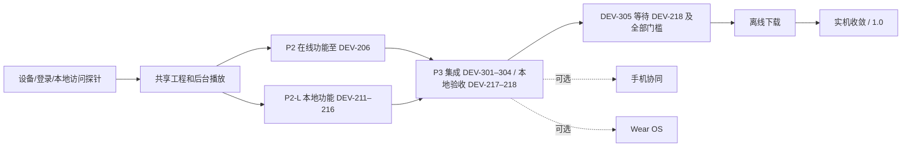

# 开发阶段与任务清单

**所有应用开发任务均未开始。** 已完成计划和上游研究，并在单独落地仓库治理与云端构建基础设施；这不代表 P0 设备验证通过。以下应用阶段只有在后续进入实施时执行。

## 1. 估算与依赖

估算假设：1 名熟悉 Kotlin、Compose、Media3 的开发者；每周 5 个工作日；可使用 Watch X2、蓝牙耳机、Wi-Fi 和测试账号；仅接网易云；首发没有手机伴侣和重型动效。人日包含本阶段实现及必要验证，不包括等待设备/账号/平台接口恢复的时间。

| 阶段 | 内容 | 工作量 | 前置条件 | 交付/退出门槛 |
| --- | --- | --- | --- | --- |
| P0 | 实机与关键技术验证 | 原基线 3–4 人日；新增 DEV-005 计入本地增量包 | 获准开始实施且设备可用 | 设备能力表；APK/登录和本地文件访问路径可行；最小后台音频与格式探针 |
| P1 | 精简工程与播放基础 | 6–8 人日 | P0 共享设备/安装/音频条件通过；业务路径分别核验 | 可安装开发包；单播放器、媒体会话、基本控制和队列恢复 |
| P2 | 账号、网易云与音乐库 | 7–10 人日 | P1；P0 登录结论 | 真实登录→列表→播放闭环；分页、错误和会话隔离通过 |
| P2-L | 本地音乐增量包 | 8–12 人日，含 P0 探针及 P3 本地性能/UI/验收增量 | P1 共享基础、DEV-005；可与在线 P2 并行 | 本地扫描/库/列表/播放闭环，无账号、无网络可用 |
| P3 | 完整圆屏 MVP 与歌词 | 原基线 6–8 人日；本地增量计入 P2-L | DEV-206 与 DEV-211–216 功能就绪；217/218 和 UI 集成收敛 | DEV-305 等待 218；在线 60 分钟、本地 120 分钟熄屏及 14/15/16 门槛通过 |
| P4 | 持久下载与离线库 | 7–10 人日 | P3；下载接口验证 | 断网可播，下载任务和存储状态可恢复 |
| P5 | 性能、兼容与发布候选 | 6–8 人日 | P4 | 1.0 候选版、完整实机报告、可复现签名构建 |
| P6（可选） | LAN 手机控制/移交 | 4–6 人日 | P3+；手机端协议可互通 | 明确播放目标，断连可恢复；不包含账号同步 |
| P7（可选） | Wear OS 兼容 | 5–8 人日 | P3+；Wear OS 测试设备 | 独立播放与主要界面通过专用验收 |

在原在线方案上增加本地能力 **8–12 人日**：首个 `0.1.0` prerelease（P0–P3，含 P2-L）由原 22–30 增至 **30–42 人日**，约 6–8.5 周；`1.0.0`（P0–P5，含 P2-L）由原 35–48 增至 **43–60 人日**，约 9–12 周。增量已包含 DEV-005 的设备/路径探针、DEV-211–218 以及 P3 本地 UI/性能/验收，不再给 P0/P3 重复加同一笔成本。

P2-L 与在线 P2 可在共享 P1 后并行协作，但人日不是日历工期；单开发者不因此自动缩短周期。共享播放器、歌词和组件可能减少重复工作，只有 P0 后确认实际重叠才调整，不保证节省。P6/P7 不在主线内，约 20% 风险余量另在实际排期时明确，设备/账号等待不计入人日。

本地增量代码量粗估为生产代码 **3–6 千行**、测试 **1–2 千行**，相对于未来共享基础计算，不是项目总量，也不是目前已实现数量；当前 Android 实现为 0。依据与拆分见 [17-本地音乐功能与实施计划](17-本地音乐功能与实施计划.md)。

## 2. P0：先消除阻断风险

| ID | 任务 | 交付及验收 |
| --- | --- | --- |
| DEV-001 | 填写 Watch X2 能力表 | 型号/SKU、API、ABI、屏幕 dp、安装方式、WebView、Google 服务、联网和表冠均有记录；未知项标明原因 |
| DEV-002 | 验证普通应用安装及后台音频 | 使用后续专门准备的最小样例，验证启动器可见、耳机输出、退后台/熄屏连续播放至少 30 分钟；记录设置条件 |
| DEV-003 | 比较扫码登录路径 | 核对原生 EAPI 与必要时 WebView 桥接；验证二维码、过期、确认及 Cookie 账号校验；输出选择或阻断结论 |
| DEV-004 | 核验初始构建与性能基线 | 使用已锁定云端工具链，应用依赖精确锁定；云端生成样例 APK，本地记录启动/内存/耗电；不在本地编译 |
| DEV-005 | 本地访问、权限与格式探针 | 按 07/17 核验 MediaStore、实际文件/目录选择器与 SAF 持久授权、重启/撤权/重授、必要导入副本和空间边界；按容器＋编码测试候选格式；输出至少一条面向用户的合法可用访问路径或阻断 |

共享停止条件：无法安装、无合法音频路径或普通应用无法稳定后台播放。业务阻断分开处理：在线网络/独立登录路径全部失败阻断在线工作；无支持的本地访问路径阻断本地工作，已经独立验证的另一条路径仍可推进。记录阻断并调整估算，不能用 root、全盘访问、硬编码私有目录或内置测试文件代替 DEV-005 通过。手机辅助登录等替代方式需要重新评估范围；本地功能不以在线登录成功为条件，但首个公开版本仍须在线与本地两条门槛全部通过，不能静默改成单一路径发布。

## 3. P1：播放基础

| ID | 任务 | 依赖 | 完成定义 |
| --- | --- | --- | --- |
| DEV-101 | 创建最小模块、版本锁和构建检查 | DEV-004 | app 与 core 边界成立；独立包名；普通安卓变体无 GMS 传递依赖；调试/候选构建明确 |
| DEV-102 | MediaSessionService + 单 ExoPlayer | DEV-101 | 本地合法测试音频可播；控制器重连不产生第二个播放器；Activity 退出不断播 |
| DEV-103 | 焦点、路由、媒体按钮和通知 | DEV-102 | 抢占/恢复策略、耳机断开暂停、系统控制通过；按 API 正确声明前台服务 |
| DEV-104 | 队列和会话恢复 | DEV-102 | 上下曲/随机/循环/seek 正确；进程结束后恢复位置和模式，默认暂停 |
| DEV-105 | 最小圆屏播放 UI | DEV-102 | 触控目标达标，按钮不被圆边裁切，加载/暂停状态清晰 |

本阶段先使用已授权测试音频，避免网络接口失效掩盖播放器问题。此处是未来验证策略，本次未准备或运行样例。

## 4. P2：在线业务闭环

| ID | 任务 | 依赖 | 完成定义 |
| --- | --- | --- | --- |
| DEV-201 | 记录最小上游代码迁移清单 | DEV-101 | 每个提取文件有来源提交、依赖、修改点；无手机 UI、插件、厂商通知反向依赖 |
| DEV-202 | 会话仓库与扫码状态机 | DEV-003、DEV-201 | 成功后校验并加密持久化；退出/重登/账号切换；旧轮询结果不能覆盖新会话 |
| DEV-203 | HTTP 与播放资源解析 | DEV-201、DEV-202 | 超时、取消、限流、过期 URL、不可播放/试听、音质降级有明确错误和测试 |
| DEV-204 | 歌单、喜欢、日推、详情与缓存 | DEV-202 | 先首屏、后分批；数据按账号隔离；缓存刷新失败仍可显示旧列表 |
| DEV-205 | 搜索与真实分页 | DEV-203 | 输入可用；取消过时请求；翻到第二页和末页；正确去重及结束判断 |
| DEV-206 | 在线播放串联 | DEV-103、DEV-104、DEV-203–205 | 实机扫码→选歌→出声→切歌→熄屏；手机离线后仍能在手表可用网络下工作 |

## 5. P2-L：本地音乐闭环

本阶段在 P1 后接入，本地 DEV-211–216 功能闭环先于 P3 集成；DEV-217/218 随 P3 界面集成收敛。与在线 P2 无账号/网络依赖，可并行推进。所有任务均未开始，详细数据契约、来源审阅与范围见 [17 本地计划](17-本地音乐功能与实施计划.md)。

| ID | 任务 | 依赖 | 完成定义 |
| --- | --- | --- | --- |
| DEV-211 | 来源授权、扫描与增量 Room 索引 | DEV-005、DEV-101 | MediaStore/可用 SAF；全局并发初始 1、分批事务、真实取消；完整扫描成功后按来源 generation 对账，失败/取消不删除未见项；导入副本仅显式触发并检查配额 |
| DEV-212 | 本地分类、搜索和排序 | DEV-211 | 歌曲/专辑/艺人/文件夹、本地收藏/列表入口；索引端真实分页，标题/艺人/专辑/文件名查询与稳定排序；至少 1000 首，不全库 JSON 或主线程 I/O |
| DEV-213 | 本地播放列表 CRUD、重排与收藏 | DEV-211、DEV-212 | 新建/查看/重命名/删除列表、增删成员/持久顺序、收藏切换；事务失败保留原状态；不删原文件，与只读在线喜欢/歌单分开 |
| DEV-214 | 本地 URI 解析接入共享播放器 | DEV-103、DEV-104、DEV-211 | 单个 MediaSessionService/ExoPlayer；按来源解析和恢复；无需账号/任何网络；URI 去重不按相同标签合并，历史使用稳定身份 |
| DEV-215 | 按需本地封面与 LRC | DEV-212、DEV-214 | 显示尺寸降采样、有界缓存；授权目录同名或明确关联 LRC；无图/坏图/无歌词/歧义不阻断音频，不全库预提取或联网补全 |
| DEV-216 | 缺失、移位、撤权/重授与清理恢复 | DEV-211、DEV-213–215 | 稳定错误、保留索引/列表/收藏/历史；可靠证据或用户确认重关联；退出/清缓存不删设备曲库；只移除来源/索引或确认删除导入副本，不提供外部原文件物理删除 UI |
| DEV-217 | 大库并行播放与资源回归 | DEV-211–216 | 至少 1000 首首扫/增量扫并行播放、搜索/排序/滚动、取消/坏文件；按 14 记录首声/PSS/帧/温度/耗电，不另设一套预算 |
| DEV-218 | 完全离线、圆屏与本地退出门槛 | DEV-217、DEV-301–304；随 P3 集成验收 | 无账号/无任何网络请求可启动、管理和播放；本地实机熄屏 120 分钟；撤权/恢复和 06 的 T-23–31、15 视觉与 16 代码审查有证据；不依赖 P4 下载 |

DEV-218 的集成验收可与 P3 界面工作并行收敛；P3 最终 DEV-305 必须等待其通过，不能把本地测试顺延至 P4/P5。

## 6. P3：圆屏在线＋本地 MVP

| ID | 任务 | 依赖 | 完成定义 |
| --- | --- | --- | --- |
| DEV-301 | 三页主界面和菜单/详情 | DEV-105、DEV-204、DEV-212–213 | 本地/在线入口明确；未登录本地可达；导航、系统返回、横向分页无冲突；列表/编辑状态和位置保留，按 15 验收 |
| DEV-302 | LRC 解析、跟随与缓存 | DEV-203、DEV-215 | 本地/在线共享时间线；切歌隔离；seek 后重新定位；缺失/异常歌词不影响音频 |
| DEV-303 | 表冠、字体和圆屏边界 | DEV-001、DEV-301 | 支持实际事件或明确触控降级；长文本/大字体/二维码可用 |
| DEV-304 | 前后台与失败状态收敛 | DEV-206、DEV-216、DEV-302 | 熄屏停止 UI 更新；在线断网/过期与本地缺失/撤权分开；重试有上限，不破坏旧库 |
| DEV-305 | 在线＋本地 MVP 验收 | DEV-301–304、DEV-218 | FR-01–08、FR-12–16 及 FR-11 本地/缓存部分通过；06 的 T-23–31、14/15/16 有证据；在线熄屏 60 分钟、本地熄屏 120 分钟均通过 |

交付：内部在线＋本地 MVP APK、设备配置、已知问题、接口风险和测试报告。公开 `0.1.0` prerelease 还需 [12 首次公开门槛](12-首个公开版本与责任清单.md) 与用户明确批准；本次不生成 APK 或标记任何门槛通过。

## 7. P4：在线持久下载与下载库

P4 扩展在线资源的持久下载，和首版已经要求的用户本地文件播放不同。下载文件仍受对应账号/资源权限约束；缓存、导入副本和外部用户文件各自清理，不能互相误删。

| ID | 任务 | 依赖 | 完成定义 |
| --- | --- | --- | --- |
| DEV-401 | 下载接口与可用性验证 | DEV-203 | 单独定义下载权限、实际音质和回退政策；无资源时不创建假完成任务 |
| DEV-402 | 持久下载任务与服务 | DEV-401 | 并发 1；Wi-Fi 约束；暂停/恢复；进程结束后索引和任务一致 |
| DEV-403 | URL 续期、完整性和空间处理 | DEV-402 | 过期续签、Range/不支持 Range、断电式中断、低空间、重复任务均有稳定结果 |
| DEV-404 | 下载库和纯离线解析 | DEV-402–403 | 飞行/断网下可选歌并播放；下载缺失有修复入口；已缓存封面/歌词可显示 |
| DEV-405 | 缓存、下载删除与账号隔离 | DEV-404 | 清缓存不删持久下载/本地音频；任务删除与文件/索引协调；切账号不串数据且本地库不受影响 |

## 8. P5：发布候选

| ID | 任务 | 依赖 | 完成定义 |
| --- | --- | --- | --- |
| DEV-501 | 实机性能和耗电测试 | P4 | 扩展 06 场景并按 14 统一预算记录数据、条件、样本量和失败项；回归在线/用户本地文件/下载，不把首版性能验收推迟至此 |
| DEV-502 | 崩溃、恢复与升级回归 | P4 | 无已知阻断崩溃；数据库升级/回退策略明确；不会因升级丢失凭证或下载索引 |
| DEV-503 | 权限和异常设备行为 | P4 | 通知拒绝、系统回收、低电模式、网络切换、耳机断连有记录；明确厂商限制 |
| DEV-504 | 来源、资源与构建产物整理 | DEV-201 | 代码来源、依赖许可、独立资源说明、版本号、独立签名配置和构建步骤齐全 |
| DEV-505 | 1.0 候选验收 | DEV-501–504 | FR-01–16 通过；14/15/16 门槛持续满足；设备适用范围公开；无阻断性数据丢失和后台播放问题 |

实际发布、上传商店或修改上游仓库不属于本次规划任务。未来 P5 产物可先供本地审阅与安装验收。

## 9. 可选扩展

| ID | 任务 | 工作边界 |
| --- | --- | --- |
| DEV-601 | LAN 发现、连接和控制 | 验证 UDP/TCP 可达；仅用户启动发现；状态和错误一致 |
| DEV-602 | 队列移交和目标切换 | 支持的 provider 才接收；接收端重新解析音源；避免两端同时误播 |
| DEV-603 | LAN 异常测试 | 手机不在线、广播受限、重连、版本不支持；不增加凭证同步 |
| DEV-701 | Wear OS 变体配置 | manifest、独立性声明、专用系统行为；主变体保持无 GMS |
| DEV-702 | Wear OS 输入与界面 | 圆屏、旋转、返回、通知和耳机控制 |
| DEV-703 | Wear OS 独立功能验收 | 无伴侣可完成核心流程；若做 Data Layer，另验证配对/包名/签名条件 |

安全账号同步、额外音源、逐字特效、Tiles/Complications 和手机输入桥接均需新增任务与估算。

## 10. 里程碑记录模板

首版另按 [18 多平台扩展约定](18-多平台音源接口与扩展约定.md) 把适配边界纳入 DEV-101、DEV-201、DEV-211–216、DEV-301–305：来源字符串身份、账号/缓存隔离、类型化资源和细分能力，以网易云/本地及测试替身验收。QQ 音乐、咪咕真实接入是后续独立任务，不额外预建平台模块、不把所有平台初始化计入首版；明显超出既有任务的工作需据实重估。

每阶段结束记录：代码提交、依赖版本、目标固件、完成 ID、测试证据、未完成项、已知限制、是否通过退出门槛、下一阶段估算调整。未通过门槛的阶段不标记完成；不能以功能演示视频替代后台稳定性和状态恢复记录。
