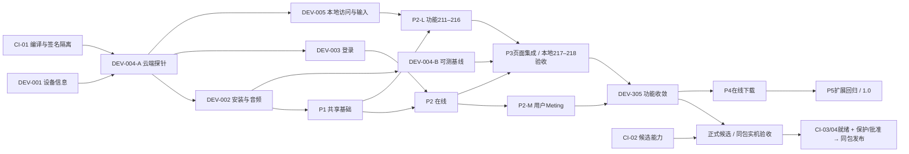

# 开发阶段与任务清单

**所有应用开发任务均未开始。** 已完成计划和上游研究，并在单独落地仓库治理与云端构建基础设施；这不代表 P0 设备验证通过。以下应用阶段只有在后续进入实施时执行。

终审入口为 [20 开工清单](20-终审结论与开工清单.md)。任务表中的“依赖”是集成/验收前置，独立模型、界面样例可先做；不能将未满足的外部依赖写成已验收。本文件是任务和工时的唯一主表。

## 1. 估算与依赖

估算假设：1名熟悉Kotlin/Compose/Media3的开发者，可使用一台实测手表（当前为Watch X2）、耳机、网络和账号；产品面向通用Android智能手表，首版提供圆/方屏能力适配，但不包含对任意机型的全面认证。人日含当前范围实现与首个基准设备验收，不含等待条件或额外机型适配、手机伴侣及重型动效。

| 阶段 | 内容 | 工作量 | 前置条件 | 交付/退出门槛 |
| --- | --- | --- | --- | --- |
| CI-01–04 | 编译/签名隔离、候选准备、同包发布与恢复、版本治理补齐 | **4–7人日**（终审补入） | 按20的时点穿插，CI-01先于可信分支APK，CI-02先于正式候选 | 云端正反例通过；不以既有规划检查替代这些实现 |
| P0 | 实机与关键技术验证 | 原基线 3–4 人日；新增 DEV-005 计入本地增量包 | 获准开始实施且设备可用 | 设备能力表；APK/登录和本地文件访问路径可行；最小后台音频与格式探针 |
| P1 | 精简工程与播放基础 | 6–8 人日 | P0 共享设备/安装/音频条件通过；业务路径分别核验 | 可安装开发包；单播放器、媒体会话、基本控制和队列恢复 |
| P2 | 账号、网易云与音乐库 | 7–10 人日 | P1；P0 登录结论 | 真实登录→列表→播放闭环；分页、错误和会话隔离通过 |
| P2-L | 本地音乐增量包 | 8–12 人日，含 P0 探针及 P3 本地性能/UI/验收增量 | P1 共享基础、DEV-005；可与在线 P2 并行 | 本地扫描/库/列表/播放闭环，无账号、无网络可用 |
| P2-M | 用户 Meting 解析服务 | 2–4 人日，初始协议及受控回归，不含服务部署/所有变体 | DEV-203、DEV-105；与本地工作独立 | DEV-221–224；用户自填、自建、默认关闭、有界解析、不影响正常路径 |
| P3 | 完整圆屏 MVP 与歌词 | 原基线 6–8 人日；本地增量计入 P2-L | DEV-206 与 DEV-211–216 功能就绪；217/218 和 UI 集成收敛 | DEV-305 等待 218；在线 60 分钟、本地 120 分钟熄屏及 14/15/16 门槛通过 |
| P4 | 持久下载与离线库 | 7–10 人日 | P3；下载接口验证 | 断网可播，下载任务和存储状态可恢复 |
| P5 | 性能、兼容与发布候选 | 6–8 人日 | P4 | 1.0候选与同产物验收；复用CI-02/03，不承诺重编译字节一致 |
| P6（可选） | LAN 手机控制/移交 | 4–6 人日 | P3+；手机端协议可互通 | 明确播放目标，断连可恢复；不包含账号同步 |
| P7（可选） | Wear OS 兼容 | 5–8 人日 | P3+；Wear OS 测试设备 | 独立播放与主要界面通过专用验收 |

功能开发原估算仍为首版32–46人日、1.0累计45–64人日；终审发现漏计CI-01–04的4–7人日，**当前完整交付估算：首版36–53人日，1.0累计49–71人日**。本地8–12已含DEV-005和本地UI/性能；Meting2–4已含设置/解析/受控回归，不重复加到P0/P3。新增CI工时不包括原DEV-004最小应用代码，避免重复计算。不是交付日期承诺，P0后重估。

P2-L 与在线 P2 可在共享 P1 后并行协作，但人日不是日历工期；单开发者不因此自动缩短周期。共享播放器、歌词和组件可能减少重复工作，只有 P0 后确认实际重叠才调整，不保证节省。P6/P7 不在主线内，约 20% 风险余量另在实际排期时明确，设备/账号等待不计入人日。

本地增量代码量粗估为生产代码 **3–6 千行**、测试 **1–2 千行**，相对于未来共享基础计算，不是项目总量，也不是目前已实现数量；当前 Android 实现为 0。依据与拆分见 [17-本地音乐功能与实施计划](17-本地音乐功能与实施计划.md)。

## 2. P0：先消除阻断风险

| ID | 任务 | 交付及验收 |
| --- | --- | --- |
| DEV-001 | 建立手表能力与兼容矩阵 | 首行使用当前Watch X2；每台记录型号/固件/API/ABI、圆或方屏/dp、安装/输入/文件/媒体能力和结果等级；不用型号替代能力判断 |
| DEV-004-A | 先生成最小云端探针 | DEV-001基础API/ABI可得、CI-01就绪；下载云端wrapper，最小app锁依赖并编译；包含安装/输入/合法音频/授权探针入口，不等P0全部通过才创建工程 |
| DEV-002 | 验证安装及后台音频 | 使用DEV-004-A云端APK；启动器可见、耳机输出、退后台/熄屏至少30分钟；基础前台服务和焦点失败可诊断 |
| DEV-003 | 比较扫码登录路径 | DEV-004-A、实际网络可用；原生EAPI与必要时WebView择一验证，记录取消/过期/账号校验；失败只阻断在线路径 |
| DEV-005 | 本地访问、输入与格式探针 | DEV-004-A；按07/17核验MediaStore/实际SAF、持久授权/重授、文件夹与LRC可见性、输入/粘贴、必要导入副本和格式；明确可用范围而非假定全支持 |
| DEV-004-B | 记录与冻结可测基线 | DEV-002安装/音频可用；同固件测启动/内存/耗电和测量分辨率，按14冻结首版阈值与替代指标；未测业务项单列，不阻断独立工作 |

旧`DEV-004`是A＋B的汇总标识，不再作为一个无法排序的单步任务。CI-02未就绪时可先用Debug探针排查功能；Debug不能冻结发布性能结论，优化基线待CI-02补验。探针直接演进为P1 app，避免两套工程漂移。

共享停止条件：无法安装、无合法音频路径或普通应用无法稳定后台播放。业务阻断分开处理：在线网络/独立登录路径全部失败阻断在线工作；无支持的本地访问路径阻断本地工作，已经独立验证的另一条路径仍可推进。记录阻断并调整估算，不能用 root、全盘访问、硬编码私有目录或内置测试文件代替 DEV-005 通过。手机辅助登录等替代方式需要重新评估范围；本地功能不以在线登录成功为条件，但首个公开版本仍须在线与本地两条门槛全部通过，不能静默改成单一路径发布。

## 3. P1：播放基础

| ID | 任务 | 依赖 | 完成定义 |
| --- | --- | --- | --- |
| DEV-101 | 扩充探针为最小应用结构 | DEV-004-A、DEV-002 | 一个app内明确模型/数据/播放/页面职责，沿用探针锁与独立包名；无GMS硬依赖；CI-02/004-B可并行补齐测量，不先创建空Gradle模块 |
| DEV-102 | MediaSessionService + 单 ExoPlayer | DEV-101 | 本地合法测试音频可播；控制器重连不产生第二个播放器；Activity 退出不断播 |
| DEV-103 | 焦点、路由、媒体按钮和通知 | DEV-102 | 自动/手动焦点只选一处负责；target35+前台条件、焦点拒绝、通知拒绝、耳机断开、播放异常回归；按API声明并启动服务 |
| DEV-104 | 队列、数据与会话恢复 | DEV-102 | 按03保存身份/顺序/随机模式；资源按需解析、有限跳过；账号隔离，Room迁移和备份排除；强停/重启后默认暂停 |
| DEV-105 | 最小圆屏播放 UI | DEV-102 | 触控目标达标，按钮不被圆边裁切，加载/暂停状态清晰 |

本阶段先使用已授权测试音频，避免网络接口失效掩盖播放器问题。此处是未来验证策略，本次未准备或运行样例。

## 4. P2：在线业务闭环

| ID | 任务 | 依赖 | 完成定义 |
| --- | --- | --- | --- |
| DEV-201 | 记录最小上游代码迁移清单 | DEV-101 | 每个提取文件有来源提交、依赖、修改点；无手机 UI、插件、厂商通知反向依赖 |
| DEV-202 | 会话仓库与扫码状态机 | DEV-003、DEV-201 | 成功后校验并加密持久化；退出/重登/账号切换；旧轮询结果不能覆盖新会话 |
| DEV-203 | HTTP 与播放资源解析 | DEV-201、DEV-202 | 超时、取消、限流、过期 URL、不可播放/试听、音质降级有明确错误和测试 |
| DEV-204 | 歌单、喜欢、日推、详情与缓存 | DEV-202 | 先首屏、后分批；数据按账号隔离；缓存刷新失败仍可显示旧列表 |
| DEV-205 | 搜索与真实分页 | DEV-203 | 输入可用；取消过时请求；翻到第二页和末页；正确去重及结束判断 |
| DEV-206 | 在线播放串联 | DEV-103、DEV-104、DEV-203–205 | 实机扫码→选歌→出声→切歌→熄屏；手机离线后仍能在手表可用网络下工作 |

## 5. P2-L：本地音乐闭环

本阶段在 P1 后接入，本地 DEV-211–216 功能闭环先于 P3 集成；DEV-217/218 随 P3 界面集成收敛。与在线 P2 无账号/网络依赖，可并行推进。所有任务均未开始，详细数据契约、来源审阅与范围见 [17 本地计划](17-本地音乐功能与实施计划.md)。

| ID | 任务 | 依赖 | 完成定义 |
| --- | --- | --- | --- |
| DEV-211 | 来源授权、扫描与增量 Room 索引 | DEV-005、DEV-101 | MediaStore/可用 SAF；全局并发初始 1、分批事务、真实取消；完整扫描成功后按来源 generation 对账，失败/取消不删除未见项；导入副本仅显式触发并检查配额 |
| DEV-212 | 本地分类、搜索和排序 | DEV-211 | 歌曲/专辑/艺人/文件夹、本地收藏/列表入口；索引端真实分页，标题/艺人/专辑/文件名查询与稳定排序；至少 1000 首，不全库 JSON 或主线程 I/O |
| DEV-213 | 本地播放列表 CRUD、重排与收藏 | DEV-211、DEV-212 | 新建/查看/重命名/删除列表、增删成员/持久顺序、收藏切换；事务失败保留原状态；不删原文件，与只读在线喜欢/歌单分开 |
| DEV-214 | 本地 URI 解析接入共享播放器 | DEV-103、DEV-104、DEV-211 | 单个 MediaSessionService/ExoPlayer；按来源解析和恢复；无需账号/任何网络；URI 去重不按相同标签合并，历史使用稳定身份 |
| DEV-215 | 按需本地封面与 LRC | DEV-212、DEV-214 | 显示尺寸降采样、有界缓存；授权目录同名或明确关联 LRC；无图/坏图/无歌词/歧义不阻断音频，不全库预提取或联网补全 |
| DEV-216 | 缺失、移位、撤权/重授与清理恢复 | DEV-211、DEV-213–215 | 稳定错误、保留索引/列表/收藏/历史；可靠证据或用户确认重关联；退出/清缓存不删设备曲库；只移除来源/索引或确认删除导入副本，不提供外部原文件物理删除 UI |
| DEV-217 | 大库并行播放与资源回归 | DEV-211–216 | 至少 1000 首首扫/增量扫并行播放、搜索/排序/滚动、取消/坏文件；按 14 记录首声/PSS/帧/温度/耗电，不另设一套预算 |
| DEV-218 | 完全离线、圆屏与本地退出门槛 | DEV-217、DEV-301–304；随 P3 集成验收 | 无账号/无任何网络请求可启动、管理和播放；本地实机熄屏 120 分钟；撤权/恢复和 06 的 T-23–31、15 视觉与 16 代码审查有证据；不依赖 P4 下载 |

DEV-218 的集成验收可与 P3 界面工作并行收敛；P3 最终 DEV-305 必须等待其通过，不能把本地测试顺延至 P4/P5。

## 6. P3：圆屏在线＋本地 MVP

### P2-M 补充任务（独立于本地路径）

完整协议与验收见 [19 Meting 自定义解析服务](19-Meting自定义解析服务.md)。不要求用户现在提供服务器；可控兼容测试服务用于验证初始协议，具体用户服务可用性另记，不冒充全曲库解锁。

| ID | 任务 | 依赖 | 完成定义 |
| --- | --- | --- | --- |
| DEV-221 | 用户 API 配置与协议契约 | DEV-101、DEV-203 | 用户自填/自建、默认关闭无公共默认值；URI/模板、服务凭据隔离、配置代次，未启用零请求 |
| DEV-222 | 兼容播放解析步骤 | DEV-221 | JSON 单曲结果/签名 URL/有限跳转，取消/限流/无效数据，正常失败后有界尝试；保留原曲目身份，共用播放器 |
| DEV-223 | 设置、测试与来源反馈 | DEV-222、DEV-105 | 圆屏填写、测试、启停和错误恢复；HTTP200不冒充可播、配置地址脱敏；不要求第三方账号 Cookie |
| DEV-224 | 受控协议与性能回归 | DEV-221–223 | 合法测试资源、协议异常/过期/跳转/取消/改地址/旧回调；正常成功路径无额外请求，本地/未启用零请求，14/15/16审查 |

### P3 集成任务

| ID | 任务 | 依赖 | 完成定义 |
| --- | --- | --- | --- |
| DEV-301 | 三页主界面和菜单/详情 | DEV-105、DEV-204、DEV-212–213 | 本地/在线入口明确；未登录本地可达；导航、系统返回、横向分页无冲突；列表/编辑状态和位置保留，按 15 验收 |
| DEV-302 | LRC 解析、跟随与缓存 | DEV-203、DEV-215 | 本地/在线共享时间线；切歌隔离；seek 后重新定位；缺失/异常歌词不影响音频 |
| DEV-303 | 输入、字体与屏幕形状适配 | DEV-001、DEV-301 | 按实际圆/方屏窗口分支布局，触控完整可用；有标准旋转事件才增强；首个真表和代表性方屏模拟分别记录，不以模拟宣称其他真机已适配 |
| DEV-304 | 前后台与失败状态收敛 | DEV-206、DEV-216、DEV-302 | 熄屏停止 UI 更新；在线断网/过期与本地缺失/撤权分开；重试有上限，不破坏旧库 |
| DEV-305 | 在线＋本地 MVP 功能收敛 | DEV-301–304、DEV-218、DEV-224、CI-02 | 范围内FR及06全部适用用例、14/15/16通过；在线60/本地120分钟熄屏、Meting受控协议有证据；随后按12对冻结候选验收，不能把一次Debug演示当发行验收 |

交付：内部在线＋本地 MVP APK、设备配置、已知问题、接口风险和测试报告。公开 `0.1.0` prerelease 还需 [12 首次公开门槛](12-首个公开版本与责任清单.md) 与用户明确批准；本次不生成 APK 或标记任何门槛通过。

阶段结果分为“实现完成”“云端通过”“实机通过”“候选获准发布”。每个改动只重测其影响与必要共享回归，最终同一候选完成全部适用必需项，不要求每个文档PR重复长时测试。CI-02候选准备不依赖DEV-305的最终报告，否则再次形成循环依赖；CI-03发布才依赖最终证据。

## 7. P4：在线持久下载与下载库

P4 扩展在线资源的持久下载，和首版已经要求的用户本地文件播放不同。下载文件仍受对应账号/资源权限约束；缓存、导入副本和外部用户文件各自清理，不能互相误删。

| ID | 任务 | 依赖 | 完成定义 |
| --- | --- | --- | --- |
| DEV-401 | 下载接口与可用性验证 | DEV-203 | 单独定义下载权限、实际音质和回退政策；无资源时不创建假完成任务 |
| DEV-402 | 持久下载任务与服务 | DEV-401 | 并发 1；Wi-Fi 约束；暂停/恢复；进程结束后索引和任务一致 |
| DEV-403 | URL 续期、完整性和空间处理 | DEV-402 | 过期续签、Range/不支持 Range、断电式中断、低空间、重复任务均有稳定结果 |
| DEV-404 | 下载库和纯离线解析 | DEV-402–403 | 飞行/断网下可选歌并播放；下载缺失有修复入口；已缓存封面/歌词可显示 |
| DEV-405 | 缓存、下载删除与账号隔离 | DEV-404 | 清缓存不删持久下载/本地音频；任务删除与文件/索引协调；切账号不串数据且本地库不受影响 |

## 8. P5：发布候选

| ID | 任务 | 依赖 | 完成定义 |
| --- | --- | --- | --- |
| DEV-501 | 实机性能和耗电测试 | P4 | 扩展 06 场景并按 14 统一预算记录数据、条件、样本量和失败项；回归在线/用户本地文件/下载，不把首版性能验收推迟至此 |
| DEV-502 | 崩溃、恢复与升级回归 | P4 | 无已知阻断崩溃；数据库升级/回退策略明确；不会因升级丢失凭证或下载索引 |
| DEV-503 | 权限和异常设备行为 | P4 | 通知拒绝、系统回收、低电模式、网络切换、耳机断连有记录；明确厂商限制 |
| DEV-504 | 来源、资源与构建产物整理 | DEV-201 | 代码来源、依赖许可、独立资源说明、版本号、独立签名配置和构建步骤齐全 |
| DEV-505 | 1.0 候选验收 | DEV-501–504 | FR-01–17 通过；14/15/16 门槛持续满足；设备适用范围公开；无阻断性数据丢失和后台播放问题 |

实际发布、上传商店或修改上游仓库不属于本次规划任务。未来 P5 产物可先供本地审阅与安装验收。

## 9. 可选扩展

| ID | 任务 | 工作边界 |
| --- | --- | --- |
| DEV-601 | LAN 发现、连接和控制 | 验证 UDP/TCP 可达；仅用户启动发现；状态和错误一致 |
| DEV-602 | 队列移交和目标切换 | 支持的 provider 才接收；接收端重新解析音源；避免两端同时误播 |
| DEV-603 | LAN 异常测试 | 手机不在线、广播受限、重连、版本不支持；不增加凭证同步 |
| DEV-701 | Wear OS 变体配置 | manifest、独立性声明、专用系统行为；主变体保持无 GMS |
| DEV-702 | Wear OS 输入与界面 | 圆屏、旋转、返回、通知和耳机控制 |
| DEV-703 | Wear OS 独立功能验收 | 无伴侣可完成核心流程；若做 Data Layer，另验证配对/包名/签名条件 |

安全账号同步、额外音源、逐字特效、Tiles/Complications 和手机输入桥接均需新增任务与估算。

## 10. 里程碑记录模板

按 [18 通用接口预留](18-通用音源接口预留.md) 将当前网易云/本地需要的解耦纳入 DEV-101、DEV-201、DEV-211–216、DEV-301–305：来源身份、账号/缓存隔离与共享资源解析，以现有实现和通用测试替身验收。未来平台及接入需求届时确定，不预设平台任务、能力边界或空模块；明显超出既有任务的工作需据实重估。

每阶段结束记录：代码提交、依赖版本、目标固件、完成 ID、测试证据、未完成项、已知限制、是否通过退出门槛、下一阶段估算调整。未通过门槛的阶段不标记完成；不能以功能演示视频替代后台稳定性和状态恢复记录。
