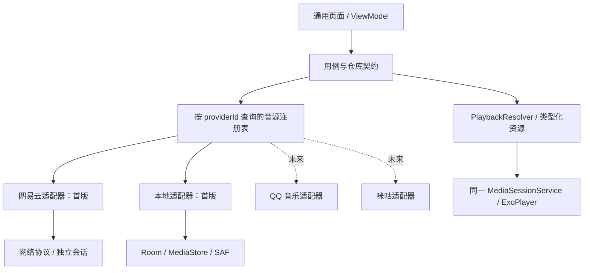

# 多平台音源接口与扩展约定

状态：已获授权的扩展性规划，尚未实现接口或新增平台。首版仍只实现**网易云在线＋本地文件**；咪咕、QQ 音乐是未来候选，不展示可用入口、不宣称已登录/可播放，也不因预留而增加 SDK、插件或空工程模块。

目标是让新音源主要通过适配器接入共享页面与唯一播放器，同时保持 [14 性能优先](14-性能优先与资源预算.md)、[15 界面质量](15-界面设计与视觉验收.md) 和 [16 可读性](16-代码规范与可读性.md)。预留适配边界属于首版工程任务，接入候选平台的业务功能属于未来单独任务。

## 1. 依赖边界

核心/UI 不导入 `Netease*`、`QQ*`、`Migu*` DTO、Cookie 字段或服务端 JSON。协议字段、签名、认证和错误码在各适配器内部转换；公共模型只保留各音源真正共用的含义。特殊平台功能可通过独立的可选能力和页面扩展，不能要求所有音源都伪造同样的接口。

开始实现时先用现有 `core/model`、`core/data` 中按职责组织的包表达这些边界；例如 `provider/netease`、`provider/local`。只有实际接入候选平台时才增加其实现包。暂不引入反射发现、远程脚本、动态插件 ABI、复杂服务定位框架或“一类配一个接口”。

## 2. 标识、账号与资源

| 契约 | 必需信息 | 不允许的简化 |
| --- | --- | --- |
| `ProviderId` | 稳定字符串；首版 `netease`、`local`，未来候选 `qqmusic`、`migu` 仅保留命名约定 | 用展示名称、枚举 ordinal 或当前选中源替代持久身份；未知源默认为网易云 |
| `TrackKey` | `providerId + trackId`，trackId 始终为字符串；本地稳定逻辑 ID | 不同平台同数字当同一首；按标题/歌手自动合并；强转 Long 导致非数字 ID 失效 |
| `PlaylistKey / AlbumKey / ArtistKey` | 相同来源命名空间规则，区分资源类型 | 把歌单 ID、榜单 ID、文件夹 ID 混用，或拿展示 ID 猜可写 ID |
| `AccountScope` | providerId、内部账号标识；本地为设备范围；匿名在线范围独立 | 全局单一登录态、全局 Cookie；退出一个平台清除本地曲库或其他平台账号 |
| `SessionSnapshot` | AccountScope、有效状态、generation、加密凭证引用 | 核心状态或日志持有明文凭证；旧登录/请求回调覆盖新账号 |
| `Track` | TrackKey、标题/艺人/专辑、可选时长/封面、来源、可用性 | 元数据存在就标可播放；未知时长当零秒；以签名 URL 当曲目 ID |
| `PlaybackResource` | 区分 `RemoteResource`、`LocalResource` 和未来 `DownloadedResource` | 所有资源都传给 HTTP；本地 URI 需要账号；把 URL 永久保存进队列 |
| `RemoteResource` | 临时 URI、必要的受控请求头、过期时间（未知时显式为空）、实际容器/编码和音质、完整/试听限制 | 将请求音质写成实际音质；伪造到期时间或可下载权；向 UI/日志泄露请求头或签名 URL |
| `LocalResource` | 已验证来源与授权的 URI、稳定本地身份、实际格式 | 猜绝对路径、自动搜索网上同名曲替换失效文件 |
| `DownloadResource` | 与播放分开的授权/解析结果、资源身份、质量与恢复约束 | 播放成功就推断允许下载；本地文件复制套用在线下载权限 |

队列条目持久化 TrackKey、元数据快照和必需的账号范围引用，不持久化短期资源。恢复时按每条曲目的来源解析，不能把“当前正在浏览的平台”用于解析整条队列。移除/禁用未来平台后，旧条目保留来源与不可用原因，不串播其他平台。

## 3. 小接口与能力声明

`MusicProvider` 只负责身份和能力描述；可选接口按实际操作分开。注册表根据 capability 找到对应实现，注册时校验声明与实现一致。这里的名称是待实现契约，不能把下表当成已经存在的源码。

| 能力边界 | 输入/输出与规则 | 首版需要 |
| --- | --- | --- |
| `SearchSongs` | 查询、分页请求、AccountScope → 统一曲目页；取消传播 | 网易云、本地 |
| `ReadLibrary / ReadPlaylists` | 账号/设备范围、分页 → 喜欢/歌单摘要与详情 | 网易云只读；本地库 |
| `ReadAlbums / ReadArtists / ReadFolders` | 对应来源 key 与分页 → 分类及曲目页 | 本地；在线按实际需要再加入 |
| `ResolvePlayback` | TrackKey、账号/generation、请求音质 → 可播放资源或明确不可用 | 网易云、本地 |
| `ReadLyrics` | TrackKey 与范围 → LyricsDocument 或明确缺失/错误 | 网易云、本地 LRC；无歌词不影响音频 |
| `Authentication` | 支持的登录方式、开始/继续/取消、校验、退出 | 网易云；本地不提供、也不需要 |
| `DailyRecommendations` | 账号范围与请求 → 有限结果页 | 网易云首版；其他平台不假定具备 |
| `FavoriteRead / FavoriteWrite` | 查状态与写状态分别声明；写入须明确成功/失败和去重语义 | 在线首版只读；本地读写 |
| `PlaylistCreate / Rename / Delete / Membership / Reorder` | 各操作分别声明可用性和资源级写权限 | 本地首版；在线写入仍为后续 |
| `ResolveDownload` | 独立于 ResolvePlayback 的资源授权与解析 | P4 在线下载再接入；本地无需此能力即可播放 |

能力状态要区分 **不支持、需要登录、当前资源无权限、临时不可用、可用**，不能只凭一个布尔值把所有失败都隐藏。静态 capability 表示适配器具有此接口；动态可用性还需结合会话、歌曲权益、网络或本地来源授权。`Unsupported` 不得返回空列表伪装“没有内容”。

### 首版与候选平台能力矩阵

| 操作 | 网易云首版 | 本地首版 | QQ 音乐 / 咪咕 |
| --- | --- | --- | --- |
| 搜索、列表、播放、歌词 | 计划实现，须实测账号/接口与分页 | 计划实现，须实测授权/格式与本地库 | 待独立调研，不声明支持 |
| 登录 | 首版扫码路线按 P0 验证 | 不需要 | 登录方式待调研；不能照搬网易云二维码假设 |
| 收藏/歌单写入 | 不在首版 | 完整本地能力必需 | 按将来的 API/权限逐操作判断 |
| 在线下载 | P4 | 不适用，不妨碍本地播放 | 待独立验证，不从播放能力推断 |
| 初始化 | 实际进入在线功能或恢复相应播放时按需建立 | 轻量读取索引，扫描由明确任务触发 | 不注册可用实例、不带 SDK、不后台探测 |

本地“歌单”和网易云歌单在共同浏览模型上可复用页面，写入行为依能力与所有权分流。用户切换来源只改变浏览范围，不自动替换队列、停止本地音频或触发所有平台登录检查。

## 4. 真实分页、错误与并发契约

- 公共 `PageRequest` 表达首次请求/续页、不透明 continuation 与有上限 pageSize。适配器内部可以使用 offset/page/cursor，但 UI 不按“网易云页码＋1”推算其他平台。
- `Page<T>` 返回 items、明确的下一页凭据及是否终止；页边界不确定时应报告协议错误或待确认能力，不能假设一次空页就代表全平台末页。未知 total 保持未知，不用当前已加载数量伪造总数。
- continuation 绑定 provider、账号/会话代次、查询和排序；切换平台/账号/查询后丢弃旧续页。对敏感续页 token 不记录日志、不跨平台复用。去重以稳定资源 key 为准，保留服务端或本地查询的稳定顺序。
- 错误统一包含 `Unsupported`、`AuthRequired`、`AuthExpired`、`RateLimited`、`NetworkUnavailable`、`NotPlayable`、`PermissionRevoked`、`FileMissing`、`UnsupportedFormat` 等领域含义，平台原始码保留在受控诊断边界；不能散落到 UI 的字符串判断中。
- 撤销/取消不是普通失败重试；新搜索/点歌只允许其绑定的 source/account/generation 提交结果。账号变化不会让另一音源的正确请求和本地库一起失效。
- 单次超时、总预算、最大尝试数、退避和并发按 14/16 记录。每个平台独立限流和鉴权上下文，故障只影响对应来源；首版不做多平台并行聚合搜索。

## 5. 性能与凭证隔离

注册表保存轻量描述和延迟创建的工厂，不在启动时构造所有平台客户端、刷新所有账号或扫描全库。未使用的平台不引入后台任务、播放器、SDK 或持续网络开销；增加接口不得成为扩大包体和启动时间的理由。

传输连接池可以在明确边界下复用，但凭证、CookieJar、账号拦截器、重定向授权、请求签名和缓存范围必须按 provider/account 隔离。不能用共享可变“当前 Cookie”在多个平台之间切换。网络请求头只到获准的来源边界，日志与页面永不展示；每个适配器记录可用域与重定向策略，不能把一个平台的认证头无条件转发给另一个平台。

元数据/封面/歌词/播放 URL 缓存键至少考虑 provider、稳定资源身份、相关账号和查询/质量参数。设备本地资源独立于在线账号。能力刷新不触发整页高频重组；通用页面只订阅当前来源必需状态。

新平台不得通过猜测同名歌曲、切换到另一平台或降级试听来假装原资源可播放。跨平台搜索匹配、自动替代和歌曲迁移是未来独立功能，首版不实现；未来即使实现，也须明确向用户展示真实来源与播放限制。

## 6. 首版需要完成的预留工作

挂接到已有任务，不另增一套多平台排期：

1. DEV-101：核心身份/AccountScope/类型化资源和轻量注册边界；网络 DTO 不穿过核心接口。
2. DEV-201：按统一契约提取网易云适配器；不复制上游完整 provider 注册表或所有平台依赖。
3. DEV-211–216：本地适配器接入相同搜索/列表/播放/歌词边界，保留设备文件授权、索引与列表专用职责。
4. DEV-301–304：页面依能力和状态展示操作；未实现的平台不出现假入口；无账号本地入口独立可达。
5. DEV-305：用网易云、本地及不联网的测试替身验证接口；同一字符串 ID 在不同来源不会冲突；未知来源明确不可用；切换来源、账号退出、旧请求回调、分页与缓存隔离均有证据。

测试替身只用来检查“假设将来平台没有日推、登录方式不同、ID 非数字或分页不同”等契约边界，不创建可发布的 QQ/咪咕模块，也不伪造它们的真实接口响应。

这部分是在首版抽取网易云与本地的工作中保持正确边界，不许为了扩展性另造通用框架；若评估出现实质新增工作量，应单独说明，不能声称未来平台接入必定零成本。

## 7. 后续接入 QQ 音乐、咪咕的步骤

1. 独立 Issue 写明所需能力与验收设备，调研合法可用的登录/账号/歌曲权益/接口、依赖、许可和平台限制；本文件不承诺任何当前 endpoint、SDK 或服务可用性。
2. 若复用上游，依据固定 SHA 制作文件与依赖迁移清单；需要新上游版本时走单独升级流程，不悄悄刷新现有代码。
3. 在独立适配包实现已验证能力，映射公共模型与错误；不支持的操作显式声明。必要的平台专用 UI 放在受控扩展处，不把协议细节传播到所有页面。
4. 注册为受控候选，补齐契约测试、脱敏样本、取消/过期/限流/分页/ID/账号隔离与失败路径；核心播放器仍为一个。
5. 运行云端编译、测试与 lint，用同条件 Watch X2 对比启动、包体、内存和耗电，验证圆屏流程及实际登录/播放。已有网易云和本地完整回归通过后再公开启用。

新增平台的发版仍由 OnlineMo 决定。预留接口不构成现在接入咪咕/QQ、改变范围或发布的授权。

## 8. 固定上游的参考边界

静态核查固定 Android 提交 `83632b17e1ee857bc428134528e0fd86c5fd4d01` 的以下文件，未运行该上游：

- `android/app/src/main/kotlin/com/lladlam/melox/core/music/provider/MusicProvider.kt`：已有身份＋细分 capability 的设计，也包含动态插件扩展；参考小接口边界，不整体移植动态注册/插件机制。
- 同目录 `MeloXMusicProviders.kt`：将多个平台实际构造成注册表；手表首版只按需接入网易云和本地，不复制它的全部客户端初始化。
- `core/provider/qqmusic/QQMusicProvider.kt` 等是未来可审阅候选，不代表已通过手表迁移或登录验证；咪咕方案另行调研，不假定此固定版本已有可复用实现。

文件均位于同一固定提交，升级规则见 [11 上游复用](11-上游复用实施指南.md)。本文件是本项目拟定的适配契约，不是对平台官方接口的背书。
