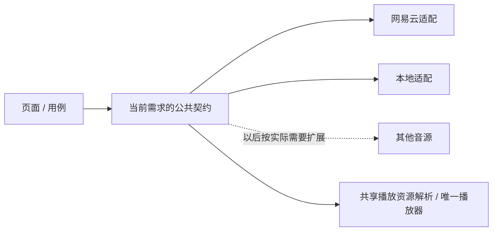

# 通用音源接口预留

状态：接口预留规划，尚未编写应用代码。**不指定未来接入哪家平台，也不预先规定其登录方式、能力集合、协议或功能范围。** 当前实现计划仍为网易云在线与本地音乐；其他来源等实际接入需求确定后再设计和验证。

本文件随项目入仓库，是开发规范的一部分；只有本地开工提示词保存在 Git 忽略目录中。

用户本轮另外明确要求了 [19 Meting 自定义解析服务](19-Meting自定义解析服务.md)，它是当前具体需求，采用可替换的解析步骤接入；这不代表其他未来音源也必须使用 Meting，原曲目来源与所用解析服务分开记录。

## 1. 现在只做必要的解耦

页面和播放器通过公共模型及实际需要的小接口调用音源。平台专用 DTO、协议字段、凭证和网络错误转换留在各自适配实现内，不能散落在 UI、队列或播放服务中。

公共部分只抽取当前网易云和本地功能已经需要的概念。将来发现不同能力或流程时，可以增加小接口、调整模型或提供专用入口；**不要求新平台硬套现有网易云流程，也不承诺所有新平台都能只加一个类完成接入。** 不为了尚不存在的需求预建空模块、插件框架、SDK 或完整平台能力表。

## 2. 首版需要保留的接口位置

| 位置 | 当前预留要求 |
| --- | --- |
| 来源与曲目身份 | `providerId + 字符串 trackId`；本地使用稳定逻辑 ID。不同来源同 ID 不冲突，未知来源不默认映射到网易云；不预留未来平台的固定名称或枚举位置 |
| 搜索与列表 | 通过当前所需的搜索、列表/歌单读取接口返回公共模型；具体网络分页或本地数据库查询留在实现内 |
| 播放资源解析 | 根据曲目来源解析远程资源或已授权本地 URI，再交给同一播放器；队列不存短期 URL，也不按当前浏览来源猜播放来源 |
| 歌词 | 输出当前需要的统一时间线与缺失/错误状态；来源如何获取和解析留在适配实现，不让页面判断平台专用返回值 |
| 账号与缓存 | 来源、账号和设备本地数据有独立范围；凭证不进入公共 UI 模型；退出在线账号不清理本地音乐或其他来源的数据 |
| 可选操作 | 当前已知差异通过小接口或能力描述表达，例如本地歌单可编辑、在线首版只读；不支持不能伪装为空数据或成功，不预先穷举未来能力 |

未来下载继续按现有 P4 计划处理；当前不要为了某个假想平台补齐尚无使用者的协议。`AccountScope`、错误和分页契约以 [03 架构](03-技术架构与接口.md) 的实际用例为起点，后续遇到真实差异再演进。

## 3. 保持性能和可读性

只创建当前需要的实现，音源注册采用清楚的显式映射即可；不在启动时探测未知平台、刷新未使用账号或实例化所有候选客户端。任何新增实现仍遵守 [14 性能预算](14-性能优先与资源预算.md)，共享唯一播放器，资源工作有上限与生命周期。

接口命名表达业务含义，输入、输出、错误、取消与资源所有者写清楚，按 [16 代码规范](16-代码规范与可读性.md) 注释。避免为了“通用”把一切塞入字符串字典、万能请求方法或多层空转抽象。通用页面只展示已经实现的实际功能，视觉规则见 [15](15-界面设计与视觉验收.md)。

## 4. 挂接到现有任务

- DEV-101：建立曲目来源、账号范围及必要资源模型，核心不依赖平台 DTO。
- DEV-201：通过这些接口接入网易云，保留平台协议在适配层。
- DEV-211–216：本地音乐复用相同播放/歌词等公共部分，文件授权、扫描和索引仍由本地实现负责。
- DEV-301–305：页面按实际实现展示功能；验证不同来源同 ID、未知来源、账号切换、旧回调、分页与缓存隔离。测试替身验证这些通用约束，不模拟某家尚未接入的平台。

以上属于现有功能实现时的解耦要求，不另建多平台项目或预定后续平台排期。真正新增音源时，先明确需求及可用接口，再决定哪些公共契约可以复用、哪些需要扩展；扩展方案与工作量到时评估。

## 5. 上游参考

固定 Android 提交 `83632b17e1ee857bc428134528e0fd86c5fd4d01` 中的 `android/app/src/main/kotlin/com/lladlam/melox/core/music/provider/MusicProvider.kt` 可供“来源身份与小能力接口”设计参考。只参考现有需求相关部分，不复制完整平台注册、动态插件或全部客户端；不把上游当前支持的平台当成本项目未来列表。固定版本与迁移规则仍见 [11 上游复用](11-上游复用实施指南.md)。
