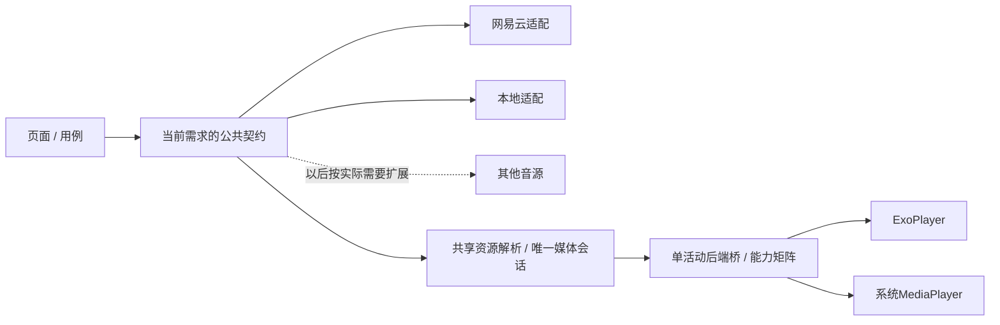

# 通用音源接口预留

状态：仅接口规划，尚未编写应用代码。当前网易云在线、用户Meting及[21](21-本地播放器全量需求整合.md)确认的**全部128项本地能力**都有明确实施责任；原13项待定现必做，运行时可关闭不等于开发可省略。未来音乐平台仍不预定名称、登录方式、能力集合或协议，按真实需求再设计验证。

本文件随项目入仓库，是开发规范的一部分；只有本地开工提示词保存在 Git 忽略目录中。

用户本轮另外明确要求了 [19 Meting 自定义解析服务](19-Meting自定义解析服务.md)，它是当前具体需求，采用可替换的解析步骤接入；这不代表其他未来音源也必须使用 Meting，原曲目来源与所用解析服务分开记录。

## 1. 现在只做必要的解耦

页面和播放器通过公共模型及实际需要的小接口调用音源。平台专用 DTO、协议字段、凭证和网络错误转换留在各自适配实现内，不能散落在 UI、队列或播放服务中。

公共部分抽取当前在线和全量本地确实需要的契约。图中后端二选一，不同时活动；源适配与播放后端是两个维度，APE/DSD解码器也不是新在线音源。将来可按真实差异增加小接口，不要求新平台硬套网易云流程，不承诺加一个类就完成。新增本地文件写入、交换、备份、主题及配套协议已有用户需求，应提供真实窄边界；未知音乐平台仍不预建SDK或插件框架。

DEV-004-A仍从单个`:app`探针开始，P1扩职责包；LP-14才建同仓库`android/:companion`，包名/版本/逐包产物按03及09/10/12，不提前建模块。这里的接口位置不是模块清单。

## 2. 首版需要保留的接口位置

| 位置 | 当前预留要求 |
| --- | --- |
| 来源与曲目身份 | `providerId + 字符串 trackId`；本地TrackKey、实体LocationId、重复QueueEntryId分离，CUE段有稳定身份与实体/起止映射。未知来源不默认网易云，不以文件名或显示别名合并 |
| 搜索与列表 | 通过当前所需的搜索、列表/歌单读取接口返回公共模型；具体网络分页或本地数据库查询留在实现内 |
| 播放资源解析 | 按TrackKey取远程资源、合法本地URI/副本或CUE段，进入当前活动后端；Meting保原身份及resolver/配置代次，来源未知不假称验证。缺本地文件不联网找同名曲 |
| 队列与恢复 | 完整本地筛选/排序结果分批物化DB、完整校验才发布generation，移除旧10000条用户上限；实际随机序/实例/有限计数持久，内存和后端窗口有界。失败保旧完整队列，不只加已显示页、不存短期URL |
| 后端及音频处理 | 唯一MediaSession、协调器及Player桥，MediaPlayer/ExoPlayer分别适配；后端/格式/路由能力和请求/实际效果分开。桥的状态/事件/命令/线程映射需实现验证，不承诺全部功能两端相同 |
| 歌词及关联资源 | 本地同名/手动/内嵌、真实行/字/译文时间及来源/偏移统一模型；F-070/F-071显式查找与本地读取是不同意图，结果预览确认后关联。字体/主题有独立授权和类型限额 |
| 账号与缓存 | 来源、账号和设备本地数据有独立范围；凭证不进入公共 UI 模型；退出在线账号不清理本地音乐或其他来源的数据 |
| 可选操作 | 当前已知差异通过小接口或能力描述表达，例如本地歌单可编辑、在线首版只读；不支持不能伪装为空数据或成功，不预先穷举未来能力 |
| 来源权限及写操作 | MediaStore/文件URI/目录是OR选项；读/持久/枚举/离线/写/删/rename/move独立核验。F-053/063/075/088由文件操作日志/精确实体/用户与系统确认管理，不把DB事务当provider原子事务 |
| 歌单与交换 | 普通歌单/文件夹规则歌单、完整分页与revision；F-051为M3U（v1候选M3U/M3U8），F-094/F-095为版本化JSON导出/导入，不是整库备份；未解析成员保留，不扩权限 |
| 备份和外观资源 | F-068/F-069显式版本化导出/暂存恢复，排除秘密/授权能力、音频默认关闭；主题无脚本、字体有系统后备，schema/字节/条目/路径/像素边界各自明确 |
| 配套会话 | LP-13认证限时文件接收及LP-14真实Android客户端，权限域/目标身份/operationId/revision/取消；只暴露必要库/歌单/显示元数据/主题能力，不提供任意路径文件接口 |

未来下载继续按现有 P4 计划处理；当前不要为了某个假想平台补齐尚无使用者的协议。`AccountScope`、错误和分页契约以 [03 架构](03-技术架构与接口.md) 的实际用例为起点，后续遇到真实差异再演进。

公共错误保留取消、离线、证书、限流、鉴权、资源不可用及部分完成/待恢复的差别，不能一切失败都触发回退。核心本地零网络；F-070/F-071默认关闭且每次明确请求，LP-13/14传输及F-118更新等各有独立授权/生命周期，不借来源初始化偷偷启动网络。进本地页不强停已有在线流。Meting请求预算、origin/凭据隔离仍按19，本地辅助不携带在线账号凭据、不自动用Meting补图/歌词。

能力信息需包含适用对象/后端/权限、未知或已验证结果与理由；“不支持”只能解释特定组合，不能将128项必需功能整项完成。每项至少一个正常AC支持路径及对应异常路径。共享source/data模型、唯一播放事件及元数据投影防止两后端、通知、手机各自产生统计/历史或第二权威状态。

## 3. 保持性能和可读性

来源注册使用明确映射，按需创建，不在启动探测未知平台/刷新未用账号/实例化所有客户端。当前128项是实施范围，内部顺序不改变范围。遵守14的有界资源/取消/生命周期，一个活动后端；容量或性能冲突提出证据、配置和实现决定，不自动删功能或把完整队列截为当前窗口。

接口命名表达业务含义，输入、输出、错误、取消与资源所有者写清楚，按 [16 代码规范](16-代码规范与可读性.md) 注释。避免为了“通用”把一切塞入字符串字典、万能请求方法或多层空转抽象。通用页面只展示已经实现的实际功能，视觉规则见 [15](15-界面设计与视觉验收.md)。

## 4. 挂接到现有任务

- DEV-101：扩充同一 app 的来源/账号/资源模型，核心不依赖平台 DTO，执行03的队列/Room事务与迁移契约。
- DEV-201：通过这些接口接入网易云，保留平台协议在适配层。
- 本地LP-00～LP-15：复用共享身份/播放/歌词，来源读写、交换、备份、外观和真实配套分别实现；历史DEV-211–218对应关系及依赖只以05为准，不用旧任务名缩小范围。
- DEV-221–224：只增加19规定的用户服务解析步骤及受控回归，正常原生路径、本地路径不增加服务请求。
- DEV-301–305：页面按实际实现展示功能；验证不同来源同 ID、未知来源、账号切换、旧回调、分页与缓存隔离。测试替身验证这些通用约束，不模拟某家尚未接入的平台。

以上是当前真实需求的解耦要求，不新增假想平台。真正新音源先明确需求和接口，再决定复用与扩展、依赖和验收；不提供人日、工期或代码量估算。来源选择与复用关系不一概当AND前置，05维护无环DAG，17解释OR及循环拆解；原F/AC不改号。

## 5. 上游参考

固定 Android 提交 `83632b17e1ee857bc428134528e0fd86c5fd4d01` 中的 `android/app/src/main/kotlin/com/lladlam/melox/core/music/provider/MusicProvider.kt` 可供“来源身份与小能力接口”设计参考。只参考现有需求相关部分，不复制完整平台注册、动态插件或全部客户端；不把上游当前支持的平台当成本项目未来列表。固定版本与迁移规则仍见 [11 上游复用](11-上游复用实施指南.md)。
